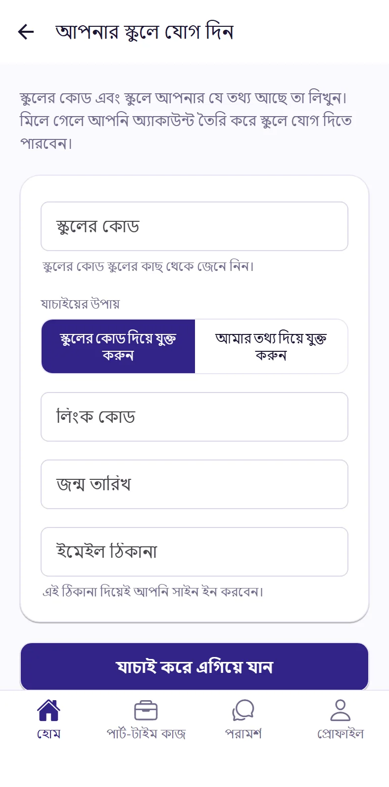
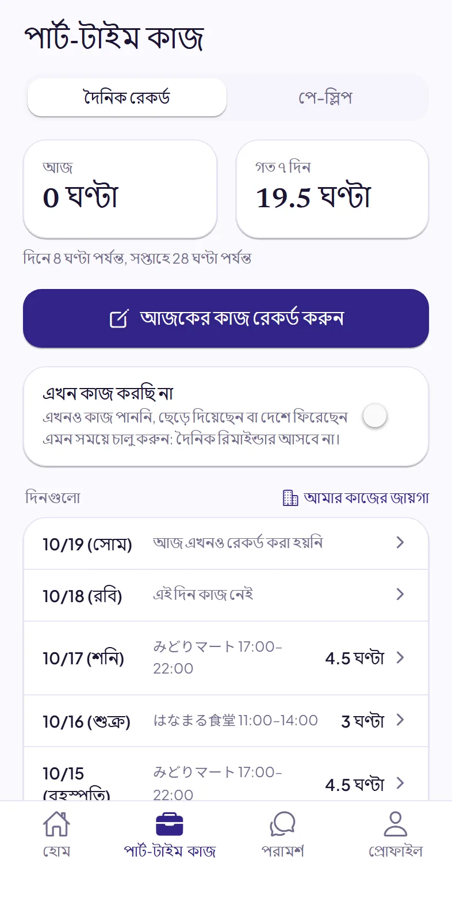
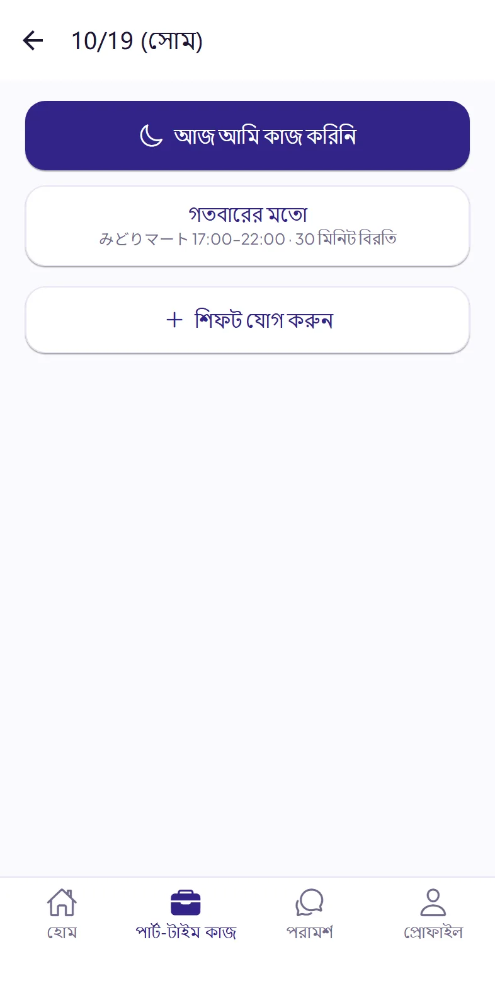
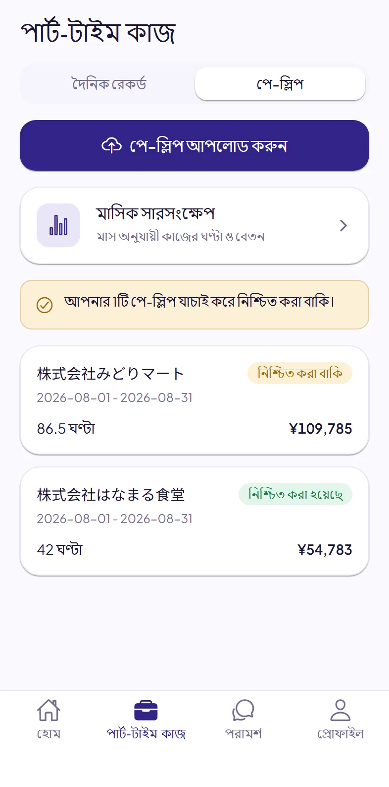
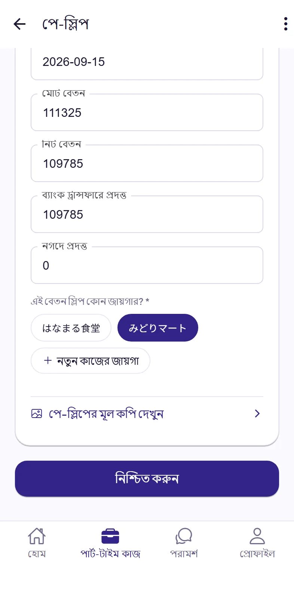
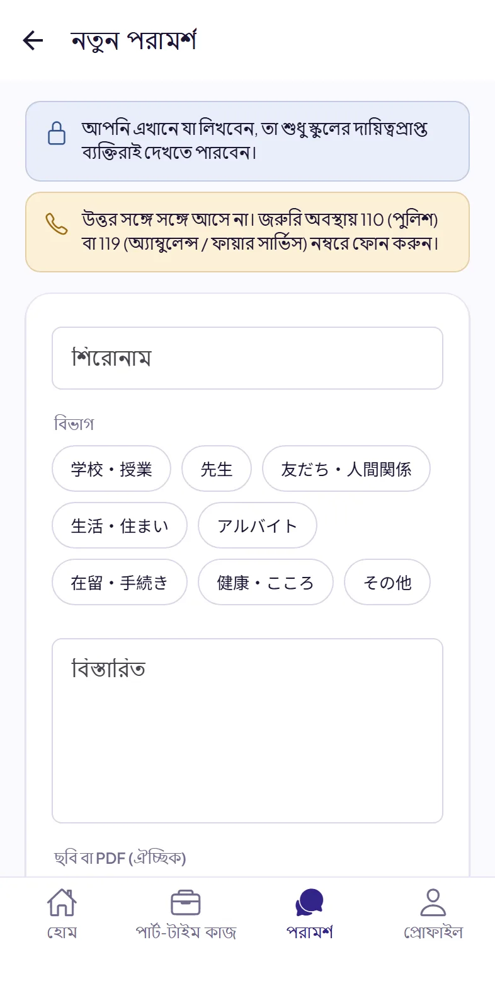
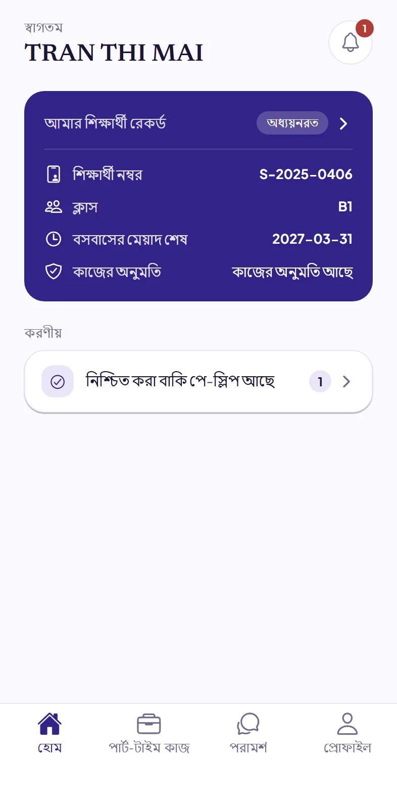

# Dignite Campus শিক্ষার্থী গাইড

- [Dignite Campus কী](#dignite-campus-ক)
- [অ্যাপ ইনস্টল করুন](#১-অযপ-ইনসটল-করন)
- [আপনার স্কুলে যোগ দিন](#২-আপনর-সকল-যগ-দন)
- [প্রতিদিন কাজ রেকর্ড করুন](#৩-পরতদন-কজ-রকরড-করন)
- [পে-স্লিপ আপলোড করুন](#৪-প-সলপ-আপলড-করন)
- [স্কুলের কাছে পরামর্শ চান](#৫-সকলর-কছ-পরমরশ-চন)
- [স্কুলের বিজ্ঞপ্তি](#৬-সকলর-বজঞপত)
- [সমস্যা হলে](#সমসয-হল)

## Dignite Campus কী

Dignite Campus হলো আপনার স্কুল যে অ্যাপ ব্যবহার করে। এতে আপনি:

- প্রতিদিন পার্ট-টাইম কাজের সময় রেকর্ড করতে পারবেন
- পে-স্লিপ আপলোড করতে পারবেন
- স্কুলের কাছে পরামর্শ চাইতে পারবেন
- স্কুলের বিজ্ঞপ্তি পাবেন

## ১. অ্যাপ ইনস্টল করুন

App Store বা Google Play-তে “Dignite Campus” খুঁজে ইনস্টল করুন। নিচের লিংক থেকেও স্টোর খুলতে পারেন; কম্পিউটারে এই নির্দেশিকা পড়লে ফোন দিয়ে QR কোড স্ক্যান করুন।

| iPhone | Android |
|:---:|:---:|
| [App Store খুলুন](https://apps.apple.com/app/dignite-campus/id6824774968) | [Google Play খুলুন](https://play.google.com/store/apps/details?id=com.dignite.campus) |
|  |  |

অ্যাপ নোটিফিকেশন পাঠানোর অনুমতি চাইলে অনুমতি দিন। তাহলেই আপনি স্কুলের উত্তর, বিজ্ঞপ্তি আর কাজ রেকর্ড করার রিমাইন্ডার পাবেন।

## ২. আপনার স্কুলে যোগ দিন

### আগে থেকে তৈরি রাখুন

- **স্কুলের কোড**: স্কুলের কাছ থেকে জেনে নিন।
- নিচের দুটির যেকোনো একটি:
  - স্কুলের দেওয়া **লিংক কোড** এবং আপনার **জন্ম তারিখ**
  - আপনার **শিক্ষার্থী নম্বর**, **জন্ম তারিখ** এবং **রেসিডেন্স কার্ড নম্বর**

### ধাপগুলো

1. অ্যাপ খুলে **আপনার স্কুলে যোগ দিন** ট্যাপ করুন।
2. স্কুলের কোড লিখুন, যাচাইয়ের উপায় বেছে নিন, তারপর ওপরে তৈরি রাখা তথ্য আর আপনার ইমেইল ঠিকানা লিখুন। পরে আপনি এই ইমেইল ঠিকানা দিয়ে লগইন করবেন।
3. **যাচাই করে এগিয়ে যান** ট্যাপ করুন।
4. যে পাতাটি খুলবে, সেখানে অ্যাকাউন্ট তৈরি করুন। আগে থেকেই অ্যাকাউন্ট থাকলে সরাসরি লগইন করুন।
5. অ্যাপে ফিরে এসে **লগইন** ট্যাপ করুন।

“আমরা নিজেরা এই তথ্য যাচাই করতে পারিনি” দেখালে স্কুলের সঙ্গে যোগাযোগ করুন। স্কুল আপনাকে একটি লিংক কোড দেবে, সেটি দিয়ে যোগ দিতে পারবেন।

## ৩. প্রতিদিন কাজ রেকর্ড করুন

অ্যাপের নিচে **পার্ট-টাইম কাজ** ট্যাপ করুন, তারপর **দৈনিক রেকর্ড** ট্যাপ করুন।

### কাজ রেকর্ড করতে

1. **আজকের কাজ রেকর্ড করুন** ট্যাপ করুন।
2. আগের বারের মতো হলে শুধু **গতবারের মতো** ট্যাপ করলেই রেকর্ড হয়ে যাবে। আলাদা হলে **শিফট যোগ করুন** ট্যাপ করুন।
3. কাজের জায়গা বেছে নিন। প্রথমবার আগে কাজের জায়গা যোগ করুন। একবার যোগ করলেই হবে।
4. শুরুর সময়, শেষের সময় আর বিরতি (মিনিট) লিখে **সংরক্ষণ** ট্যাপ করুন।

- রাতের শিফট পরের দিন পর্যন্ত গড়ালেও একটি রেকর্ড হিসেবেই লিখুন।
- শিফট যোগ করার সময় **আগের বারের মতো** ট্যাপ করে আগের বারের তথ্য বসিয়ে নিয়ে তারপর বদলাতে পারেন।
- যেদিন লিখতে ভুলে গেছেন, পরে তালিকায় সেই দিনটি ট্যাপ করে লিখে নিতে পারবেন।

**কাজ না করার দিন:** **আজকের কাজ রেকর্ড করুন** ট্যাপ করার পর **আজ আমি কাজ করিনি** ট্যাপ করুন।

**কিছুদিন কাজ না করলে:** এখনও কাজ পাননি, কাজ ছেড়ে দিয়েছেন বা দেশে ফিরেছেন—এমন সময় **এখন কাজ করছি না** চালু করুন। তখন প্রতিদিনের রিমাইন্ডার আর আসবে না। কাজ শুরু করলে এটি বন্ধ করুন।

স্কুলের ঠিক করা সময়ের মধ্যে রেকর্ড না করলে অ্যাপ আপনাকে মনে করিয়ে দেবে। অ্যাপে **আজ** ও **গত ৭ দিন**-এ কত ঘণ্টা কাজ করেছেন এবং আপনার জন্য প্রযোজ্য সীমা দেখা যায়।

## ৪. পে-স্লিপ আপলোড করুন

**পার্ট-টাইম কাজ**-এর ভেতরে **পে-স্লিপ** ট্যাপ করুন।

1. **পে-স্লিপ আপলোড করুন** ট্যাপ করে **ছবি তুলুন**, **ছবি বেছে নিন** বা **ফাইল বেছে নিন (PDF)** বেছে নিন।
2. প্রথমবার আপলোড করার সময় “AI দিয়ে আপনার কাগজপত্র পড়া” নামে একটি ব্যাখ্যা দেখাবে। পড়ে **আমি সম্মত, এগিয়ে যান** ট্যাপ করুন।
3. পড়ার কাজ সাধারণত কয়েক মিনিটেই শেষ হয়। পে-স্লিপ খুলে তারিখ, ঘণ্টা আর পরিমাণ কাগজের পে-স্লিপের সঙ্গে মিলিয়ে দেখুন। ভুল থাকলে ঠিক করুন।
4. এই পে-স্লিপটি কোন কাজের জায়গার, তা বেছে নিয়ে **নিশ্চিত করুন** ট্যাপ করুন।
5. এরপর এই বেতন জমা হওয়া দেখা যায় এমন **ব্যাংক স্টেটমেন্টের স্ক্রিনশট** আপলোড করুন (**ব্যাংক স্টেটমেন্ট আপলোড করুন** ট্যাপ করুন)। জমা খুঁজে পেলে “ব্যাংক স্টেটমেন্টে এই বেতন জমা হওয়া পাওয়া গেছে” দেখাবে।

## ৫. স্কুলের কাছে পরামর্শ চান

কোনো সমস্যা হলে বা কিছু বুঝতে না পারলে স্কুলকে জানাতে পারেন।

1. অ্যাপের নিচে **পরামর্শ** ট্যাপ করুন, তারপর **নতুন পরামর্শ** ট্যাপ করুন।
2. বিভাগ বেছে নিয়ে শিরোনাম আর বিস্তারিত লিখুন। আপনার সুবিধামতো যেকোনো ভাষায় লিখতে পারেন। ছবি বা PDF-ও যুক্ত করতে পারেন।
3. **পাঠান** ট্যাপ করুন।

স্কুল উত্তর দিলে আপনি নোটিফিকেশন পাবেন। আপনি যা লেখেন, তা শুধু স্কুলের দায়িত্বপ্রাপ্ত কর্মীরাই দেখতে পারেন।

> উত্তর সঙ্গে সঙ্গে আসে না। জরুরি অবস্থায় **110** (পুলিশ) বা **119** (অ্যাম্বুলেন্স, ফায়ার সার্ভিস) নম্বরে কল করুন।

## ৬. স্কুলের বিজ্ঞপ্তি

স্কুলের পাঠানো বিজ্ঞপ্তি দেখতে হোম স্ক্রিনের ওপরে ডানদিকের ঘণ্টায় ট্যাপ করুন। নতুন বিজ্ঞপ্তি এলে ফোনেও জানানো হবে।

## সমস্যা হলে

- **স্কুলের কোড জানেন না:** স্কুলের কাছে জিজ্ঞেস করুন।
- **লিংক কোডের মেয়াদ শেষ বা কাজ করছে না:** স্কুলের কাছে নতুন লিংক কোড চান।
- **নতুন রেসিডেন্স কার্ড পেয়েছেন:** স্কুলকে জানান।
- **নোটিফিকেশন আসছে না:** ফোনের সেটিংসে Dignite Campus-কে নোটিফিকেশন পাঠানোর অনুমতি দিন। Android ফোনে Dignite Campus-এর ব্যাটারি ব্যবহারে কোনো বিধিনিষেধ না রাখার অপশন (Unrestricted) বেছে নিন।
