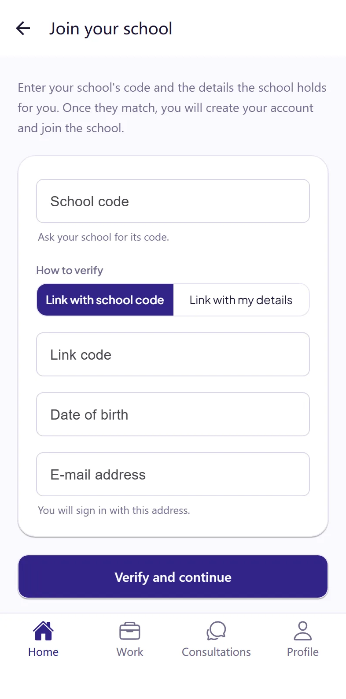
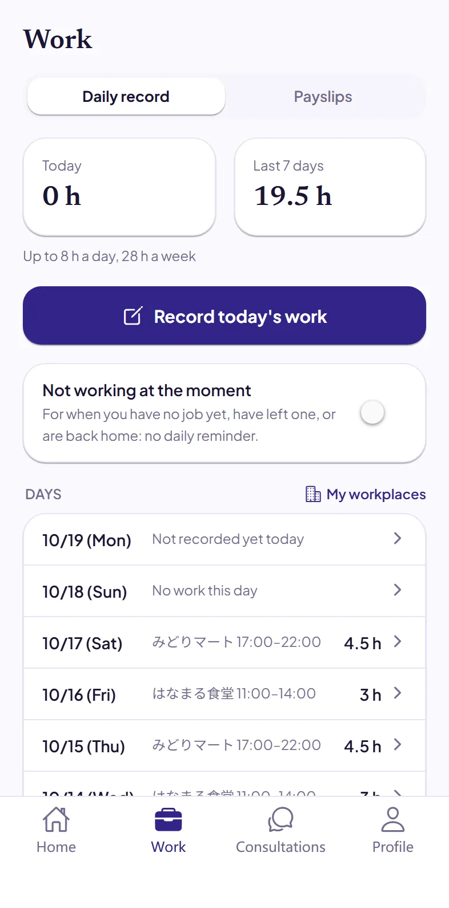
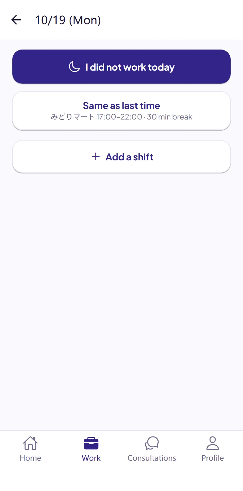
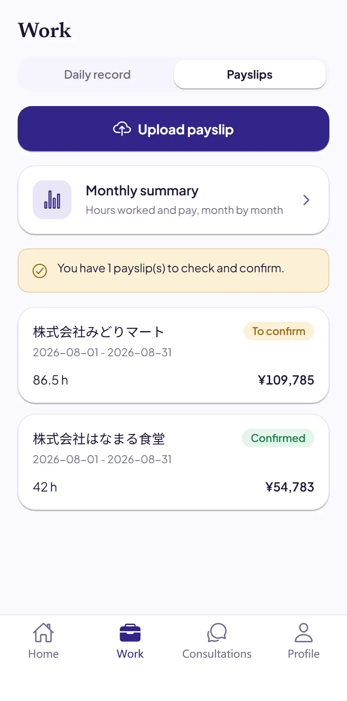
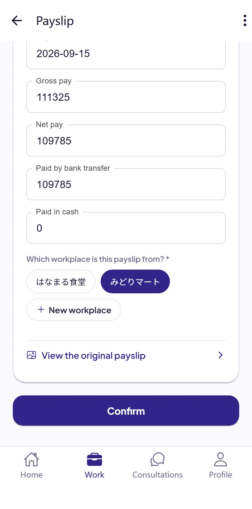
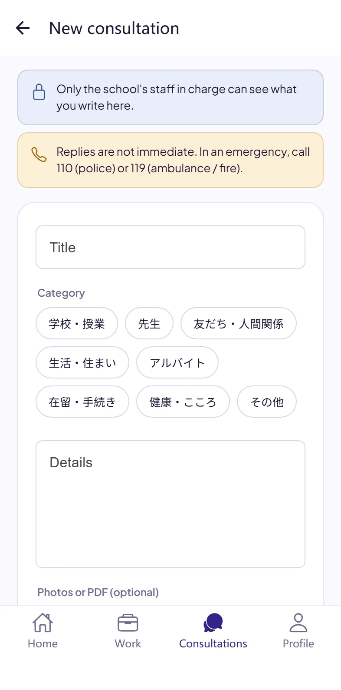
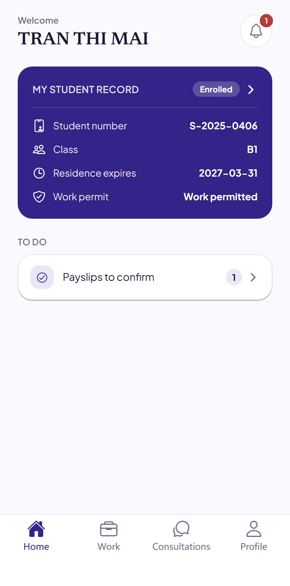

# Dignite Campus student guide

- [What is Dignite Campus](#what-is-dignite-campus)
- [Install the app](#1-install-the-app)
- [Join your school](#2-join-your-school)
- [Record your work every day](#3-record-your-work-every-day)
- [Upload your payslips](#4-upload-your-payslips)
- [Ask your school](#5-ask-your-school)
- [School announcements](#6-school-announcements)
- [If something goes wrong](#if-something-goes-wrong)

## What is Dignite Campus

Dignite Campus is the app your school uses. With it you can:

- record your part-time work hours every day
- upload your payslips
- ask your school for help
- get announcements from your school

## 1. Install the app

Search for “Dignite Campus” on the App Store or Google Play and install it.

<!-- The App Store and Google Play badges go here once the app is in the stores. -->

When the app asks to send you notifications, choose “Allow”. Then you will get your school's replies and announcements, and reminders to record your work.

## 2. Join your school

### Have these ready

- **School code**: ask your school.
- One of the following:
  - the **Link code** your school gave you, and your **Date of birth**
  - your **Student number**, **Date of birth** and **Residence card number**

### Steps

1. Open the app and tap **Join your school**.
2. Enter the school code, choose how to verify, then enter the details above and your e-mail address. You will sign in with this e-mail address.
3. Tap **Verify and continue**.
4. Create your account on the page that opens. If you already have an account, just sign in.
5. Back in the app, tap **Sign in**.

If you see “We could not verify these details on our own”, contact your school. They will give you a link code to join with.

## 3. Record your work every day

At the bottom of the app, tap **Work**, then **Daily record**.

### To record your work

1. Tap **Record today's work**.
2. If it is the same as last time, just tap **Same as last time** and it is recorded. If not, tap **Add a shift**.
3. Choose the workplace. The first time, add your workplace first. You only need to add it once.
4. Enter the start time, end time and break (in minutes), then tap **Save**.

- A night shift that goes past midnight is still one record.
- When adding a shift, you can also tap **Same as last time** to fill in last time's details and then change them.
- You can fill in days you forgot later: tap the day in the list.

**Days without work:** tap **Record today's work**, then **I did not work today**.

**When you are not working for a while:** if you have not found a job yet, have quit, or are back in your home country, turn on **Not working at the moment**. The daily reminder stops. Turn it off when you start working again.

If you have not recorded your work by the time your school set, the app reminds you. The app shows the hours you worked **Today** and in the **Last 7 days**, and the limit that applies to you.

## 4. Upload your payslips

In **Work**, tap **Payslips**.

1. Tap **Upload payslip** and choose **Take a photo**, **Choose a photo** or **Choose a file (PDF)**.
2. The first time, an explanation called “Reading your documents with AI” appears. Read it and tap **I agree and continue**.
3. Reading the payslip usually takes a few minutes. Open it and check the dates, hours and amounts against your paper payslip. Correct anything that is wrong.
4. Choose the workplace this payslip is from, and tap **Confirm**.
5. Next, upload a **screenshot of your bank statement** that shows this pay arriving (tap **Upload bank statement**). When the payment is found, you will see “The pay was found in your bank statement”.

## 5. Ask your school

If you have a problem, or something you do not understand, you can tell your school.

1. At the bottom of the app, tap **Consultations**, then **New consultation**.
2. Choose a category, and write a title and the details. You can write in any language you like. You can also attach photos or PDFs.
3. Tap **Send**.

When your school replies, you get a notification. Only the school staff in charge can see what you write.

> Replies do not come right away. In an emergency, call **110** (police) or **119** (ambulance, fire).

## 6. School announcements

To read announcements from your school, tap the bell at the top right of the home screen. When there is a new one, your phone notifies you too.

## If something goes wrong

- **You do not know the school code:** ask your school.
- **Your link code has expired or does not work:** ask your school for a new one.
- **You got a new residence card:** tell your school.
- **You get no notifications:** in your phone's settings, allow Dignite Campus to send notifications. On Android, also set Dignite Campus's battery usage to “Unrestricted”.
