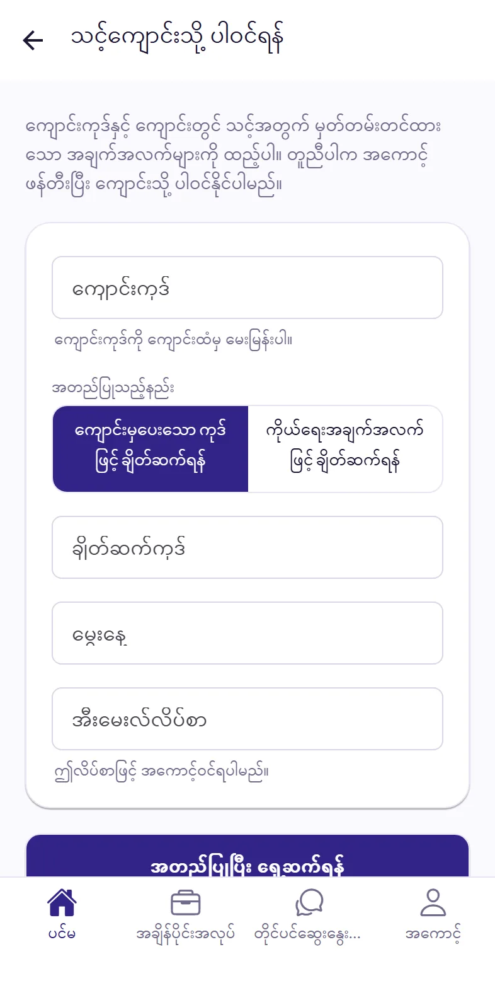
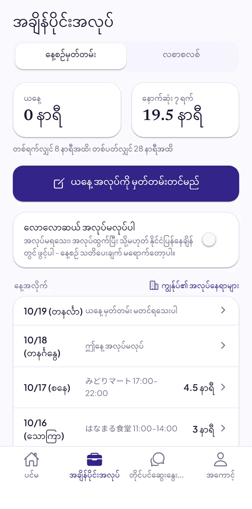
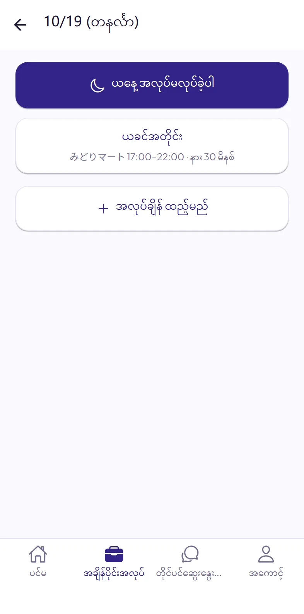
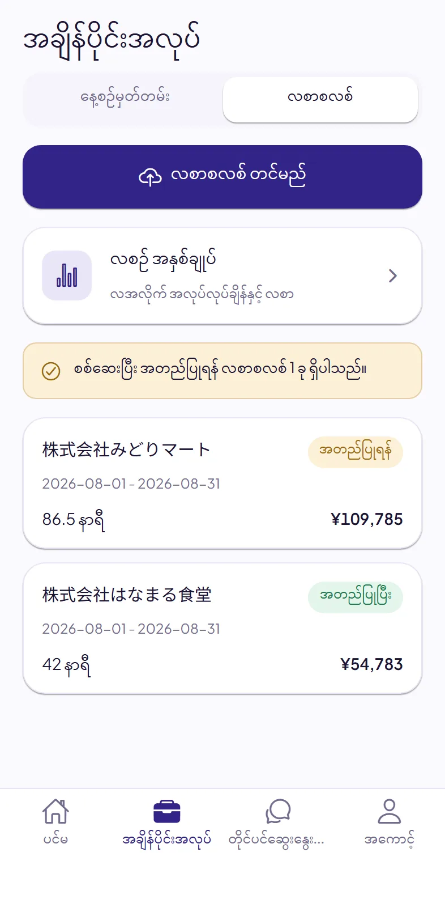
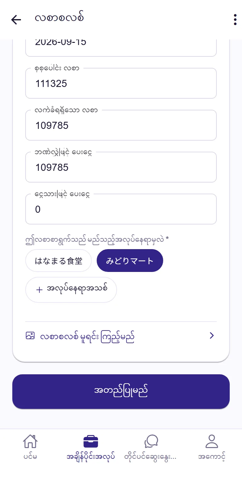
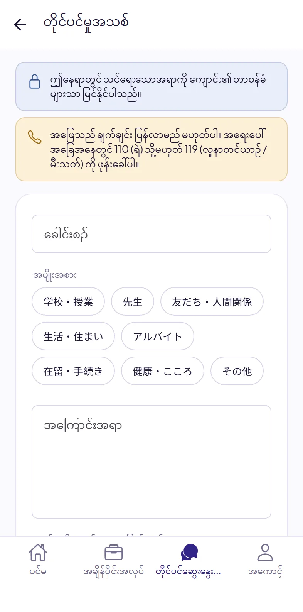
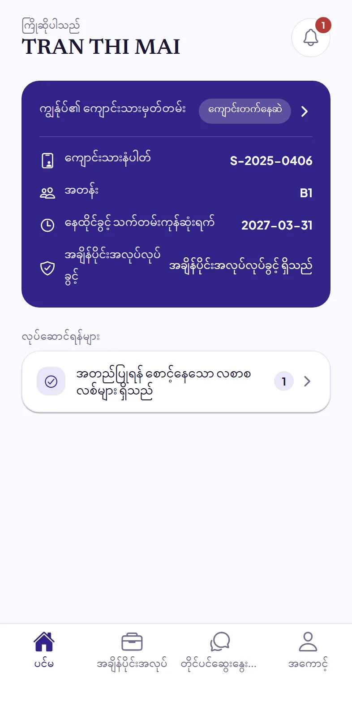

# Dignite Campus ကျောင်းသားလမ်းညွှန်

- [Dignite Campus ဆိုသည်မှာ](#dignite-campus-ဆသညမ)
- [အက်ပ်ကို ထည့်သွင်းပါ](#၁-အကပက-ထညသငပ)
- [သင့်ကျောင်းသို့ ပါဝင်ပါ](#၂-သငကငသ-ပဝငပ)
- [နေ့စဉ် အလုပ်ကို မှတ်တမ်းတင်ပါ](#၃-နစဉ-အလပက-မတတမတငပ)
- [လစာစလစ် တင်ပါ](#၄-လစစလစ-တငပ)
- [ကျောင်းနှင့် တိုင်ပင်ဆွေးနွေးပါ](#၅-ကငနင-တငပငဆနပ)
- [ကျောင်းကြေညာချက်များ](#၆-ကငကညခကမ)
- [ပြဿနာ ရှိလျှင်](#ပဿန-ရလင)

## Dignite Campus ဆိုသည်မှာ

Dignite Campus သည် သင့်ကျောင်းက အသုံးပြုသော အက်ပ်ဖြစ်သည်။ ဤအက်ပ်ဖြင့်—

- နေ့စဉ် အချိန်ပိုင်းအလုပ် လုပ်ချိန်ကို မှတ်တမ်းတင်နိုင်သည်
- လစာစလစ် တင်နိုင်သည်
- ကျောင်းနှင့် တိုင်ပင်ဆွေးနွေးနိုင်သည်
- ကျောင်း၏ ကြေညာချက်များကို လက်ခံရရှိနိုင်သည်

## ၁။ အက်ပ်ကို ထည့်သွင်းပါ

App Store သို့မဟုတ် Google Play တွင် “Dignite Campus” ကို ရှာပြီး ထည့်သွင်းပါ။ အောက်ပါ လင့်ခ်များမှလည်း စတိုးကို ဖွင့်နိုင်ပါသည်။ ဤလမ်းညွှန်ကို ကွန်ပျူတာတွင် ဖတ်နေပါက ဖုန်းဖြင့် QR ကုဒ်ကို စကင်န်ဖတ်ပါ။

| iPhone | Android |
|:---:|:---:|
| [App Store ကို ဖွင့်ပါ](https://apps.apple.com/app/dignite-campus/id6824774968) | [Google Play ကို ဖွင့်ပါ](https://play.google.com/store/apps/details?id=com.dignite.campus) |
|  |  |

အက်ပ်က အသိပေးချက် ပို့ရန် ခွင့်တောင်းသောအခါ ခွင့်ပြုပါ။ ခွင့်ပြုထားမှသာ ကျောင်း၏ အကြောင်းပြန်ချက်၊ ကြေညာချက်နှင့် အလုပ်မှတ်တမ်းတင်ရန် သတိပေးချက်များကို ရရှိမည်။

## ၂။ သင့်ကျောင်းသို့ ပါဝင်ပါ

### ကြိုတင် ပြင်ဆင်ထားရန်

- **ကျောင်းကုဒ်**: ကျောင်းကို မေးပါ။
- သင့် **ကျောင်းသားနံပါတ်**၊ **မွေးနေ့** နှင့် **နေထိုင်ခွင့်ကတ်နံပါတ်**။

### အဆင့်များ

1. အက်ပ်ကိုဖွင့်ပြီး **သင့်ကျောင်းသို့ ပါဝင်ရန်** ကို နှိပ်ပါ။
2. ကျောင်းကုဒ်ကို ရိုက်ထည့်ပြီး **ကိုယ်ရေးအချက်အလက်ဖြင့် ချိတ်ဆက်ရန်** ကို ရွေးပါ။ ထို့နောက် ကျောင်းသားနံပါတ်၊ မွေးနေ့၊ နေထိုင်ခွင့်ကတ်နံပါတ်နှင့် သင့်အီးမေးလ်လိပ်စာကို ရိုက်ထည့်ပါ။ နောက်ပိုင်းတွင် ဤအီးမေးလ်လိပ်စာဖြင့် အကောင့်ဝင်ရမည်။
3. **အတည်ပြုပြီး ရှေ့ဆက်ရန်** ကို နှိပ်ပါ။
4. ပွင့်လာသော စာမျက်နှာတွင် အကောင့်ဖွင့်ပါ။ အကောင့်ရှိပြီးသားဆိုလျှင် တိုက်ရိုက် အကောင့်ဝင်ပါ။
5. အက်ပ်သို့ ပြန်လာပြီး **အကောင့်ဝင်မည်** ကို နှိပ်ပါ။

သင့်ကိုယ်ပိုင်အချက်အလက်ဖြင့် ကိုယ်တိုင် အတည်ပြုနိုင်ပြီး ကျောင်း၏ အကူအညီ မလိုပါ။ “ဤအချက်အလက်များကို ကျွန်ုပ်တို့ကိုယ်တိုင် အတည်မပြုနိုင်ပါ” ဟု ပြလျှင် ကျောင်းကို ဆက်သွယ်ပါ။ ကျောင်းက ချိတ်ဆက်ကုဒ်တစ်ခု ပေးမည်ဖြစ်ပြီး **ကျောင်းမှပေးသော ကုဒ်ဖြင့် ချိတ်ဆက်ရန်** ကို ရွေးကာ ကုဒ်နှင့် မွေးနေ့ကို ရိုက်ထည့်ပါက ပါဝင်နိုင်သည်။

## ၃။ နေ့စဉ် အလုပ်ကို မှတ်တမ်းတင်ပါ

အက်ပ်၏ အောက်ခြေရှိ **အချိန်ပိုင်းအလုပ်** ကို နှိပ်ပြီး **နေ့စဉ်မှတ်တမ်း** ကို နှိပ်ပါ။

### အလုပ်ကို မှတ်တမ်းတင်ရန်

1. **ယနေ့ အလုပ်ကို မှတ်တမ်းတင်မည်** ကို နှိပ်ပါ။
2. ယခင်အတိုင်းဖြစ်လျှင် **ယခင်အတိုင်း** ကို နှိပ်လိုက်ရုံဖြင့် မှတ်တမ်းတင်ပြီးပါပြီ။ မတူလျှင် **အလုပ်ချိန် ထည့်မည်** ကို နှိပ်ပါ။
3. အလုပ်နေရာကို ရွေးပါ။ ပထမဆုံးအကြိမ်တွင် အလုပ်နေရာကို အရင်ထည့်ပါ။ တစ်ကြိမ်သာ ထည့်ရန် လိုသည်။
4. စချိန်၊ ပြီးချိန်နှင့် နားချိန် (မိနစ်) ကို ဖြည့်ပြီး **သိမ်းမည်** ကို နှိပ်ပါ။

- ညဆိုင်းက နောက်တစ်ရက်အထိ ကူးသွားလည်း မှတ်တမ်းတစ်ခုတည်းအဖြစ် ဖြည့်ပါ။
- အလုပ်ချိန် ထည့်သောအခါ **ယခင်အတိုင်း** ကို နှိပ်၍ ယခင်အချက်အလက်ကို ဖြည့်ပြီးမှ ပြင်နိုင်သည်။
- ဖြည့်ရန် မေ့ခဲ့သော ရက်များကို နောက်မှ စာရင်းထဲရှိ ထိုရက်ကို နှိပ်၍ ဖြည့်နိုင်သည်။

**အလုပ်မလုပ်သော နေ့:** **ယနေ့ အလုပ်ကို မှတ်တမ်းတင်မည်** ကို နှိပ်ပြီးနောက် **ယနေ့ အလုပ်မလုပ်ခဲ့ပါ** ကို နှိပ်ပါ။

**အလုပ် ခေတ္တမလုပ်သောအခါ:** အလုပ်မရသေးချိန်၊ အလုပ်ထွက်ပြီးချိန် သို့မဟုတ် နိုင်ငံပြန်နေချိန်တွင် **လောလောဆယ် အလုပ်မလုပ်ပါ** ကို ဖွင့်ထားပါ။ နေ့စဉ် သတိပေးချက် မရောက်တော့ပါ။ အလုပ်စလုပ်သောအခါ ပြန်ပိတ်ပါ။

ကျောင်းက သတ်မှတ်ထားသော အချိန်အထိ မှတ်တမ်းမတင်ရသေးလျှင် အက်ပ်က သတိပေးမည်။ အက်ပ်တွင် **ယနေ့** နှင့် **နောက်ဆုံး ၇ ရက်** အလုပ်လုပ်ခဲ့သော နာရီနှင့် သင့်အတွက် သက်ဆိုင်သော ကန့်သတ်ချက်ကို ကြည့်နိုင်သည်။

## ၄။ လစာစလစ် တင်ပါ

**အချိန်ပိုင်းအလုပ်** ထဲတွင် **လစာစလစ်** ကို နှိပ်ပါ။

1. **လစာစလစ် တင်မည်** ကို နှိပ်ပြီး **ဓာတ်ပုံ ရိုက်မည်**၊ **ဓာတ်ပုံ ရွေးမည်** သို့မဟုတ် **ဖိုင် ရွေးမည် (PDF)** ကို ရွေးပါ။
2. ပထမဆုံးအကြိမ် တင်သောအခါ “AI ဖြင့် သင့်စာရွက်စာတမ်းများကို ဖတ်ခြင်း” ရှင်းလင်းချက် ပေါ်လာမည်။ ဖတ်ပြီးနောက် **သဘောတူပြီး ဆက်လုပ်မည်** ကို နှိပ်ပါ။
3. ဖတ်ရှုခြင်းသည် များသောအားဖြင့် မိနစ်အနည်းငယ်အတွင်း ပြီးသည်။ လစာစလစ်ကို ဖွင့်ပြီး ရက်စွဲ၊ အလုပ်ချိန်နှင့် ငွေပမာဏကို စာရွက်လစာစလစ်နှင့် တိုက်စစ်ပါ။ မှားနေသည့် နေရာကို ပြင်ပါ။
4. ဤလစာစလစ်၏ အလုပ်နေရာကို ရွေးပြီး **အတည်ပြုမည်** ကို နှိပ်ပါ။
5. ထို့နောက် ဤလစာ ဝင်ထားကြောင်း ပြသော **ဘဏ်စာရင်းရှင်းတမ်း စခရင်ရှော့** ကို တင်ပါ (**ဘဏ်စာရင်းရှင်းတမ်း တင်မည်** ကို နှိပ်ပါ)။ ဝင်ငွေကို တွေ့လျှင် “ဘဏ်စာရင်းရှင်းတမ်းတွင် ဤလစာ ဝင်ငွေကို တွေ့ရှိပါသည်” ဟု ပြမည်။

## ၅။ ကျောင်းနှင့် တိုင်ပင်ဆွေးနွေးပါ

အခက်အခဲရှိလျှင် သို့မဟုတ် နားမလည်သည်များ ရှိလျှင် ကျောင်းကို ပြောပြနိုင်သည်။

1. အက်ပ်၏ အောက်ခြေရှိ **တိုင်ပင်ဆွေးနွေးခြင်း** ကို နှိပ်ပြီး **တိုင်ပင်မှုအသစ် ပြုလုပ်ရန်** ကို နှိပ်ပါ။
2. အမျိုးအစားကို ရွေးပြီး ခေါင်းစဉ်နှင့် အကြောင်းအရာကို ရေးပါ။ မိမိအဆင်ပြေသော ဘာသာစကားဖြင့် ရေးနိုင်သည်။ ဓာတ်ပုံ သို့မဟုတ် PDF ကိုလည်း ပူးတွဲနိုင်သည်။
3. **ပို့မည်** ကို နှိပ်ပါ။

ကျောင်းက အကြောင်းပြန်သောအခါ အသိပေးချက် ရရှိမည်။ သင်ရေးသော အကြောင်းအရာကို ကျောင်း၏ တာဝန်ခံဝန်ထမ်းများသာ ကြည့်နိုင်သည်။

> အကြောင်းပြန်ချက်သည် ချက်ချင်း မရောက်ပါ။ အရေးပေါ်အခြေအနေတွင် **110** (ရဲ) သို့မဟုတ် **119** (လူနာတင်ယာဉ်၊ မီးသတ်) ကို ဖုန်းခေါ်ပါ။

## ၆။ ကျောင်းကြေညာချက်များ

ကျောင်းမှ ပို့သော ကြေညာချက်များကို ကြည့်ရန် ပင်မစာမျက်နှာ၏ ညာဘက်အပေါ်ထောင့်ရှိ ခေါင်းလောင်းကို နှိပ်ပါ။ ကြေညာချက်အသစ် ရှိလျှင် ဖုန်းသို့လည်း အသိပေးချက် ရောက်လာမည်။

## ပြဿနာ ရှိလျှင်

- **ကျောင်းကုဒ်ကို မသိလျှင်:** ကျောင်းကို မေးပါ။
- **ချိတ်ဆက်ကုဒ် သက်တမ်းကုန်သွားလျှင် သို့မဟုတ် သုံး၍မရလျှင်:** ကျောင်းထံမှ ချိတ်ဆက်ကုဒ်အသစ် တောင်းပါ။
- **နေထိုင်ခွင့်ကတ် အသစ်ရလျှင်:** ကျောင်းကို အသိပေးပါ။
- **အသိပေးချက် မရောက်လျှင်:** ဖုန်း၏ ဆက်တင်တွင် Dignite Campus ကို အသိပေးချက် ပို့ခွင့်ပြုပါ။ Android ဖုန်းဖြစ်လျှင် Dignite Campus ၏ ဘက်ထရီအသုံးပြုမှုကို ကန့်သတ်ချက်မရှိ (Unrestricted) ဟု သတ်မှတ်ပါ။
