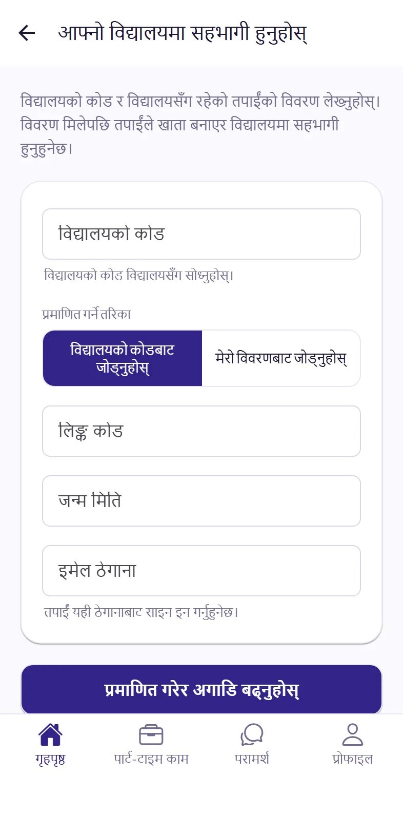
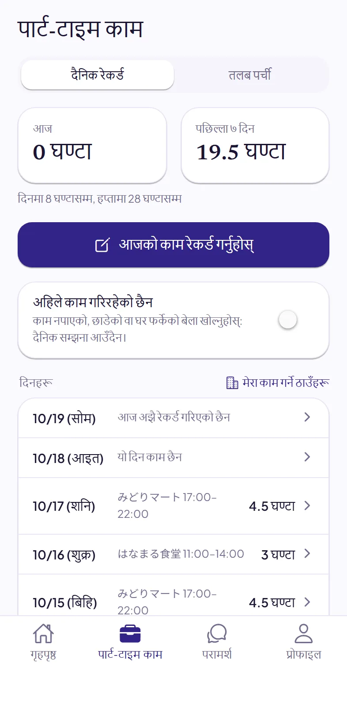
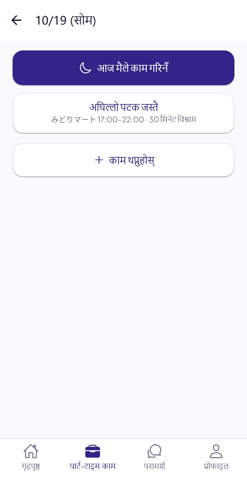
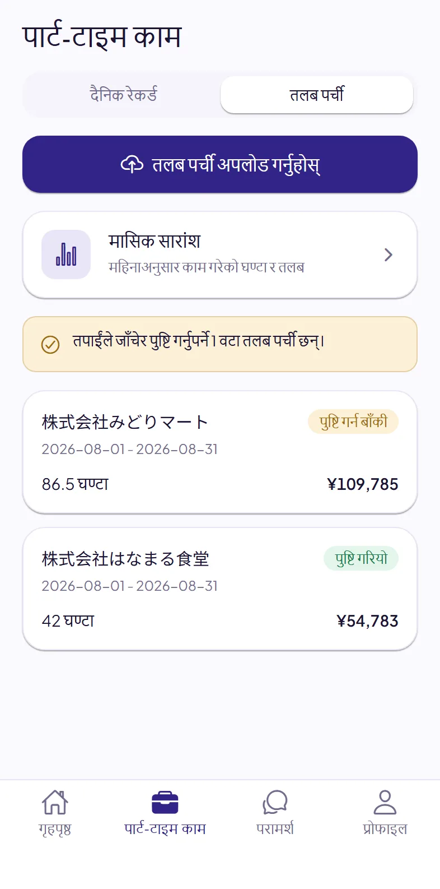
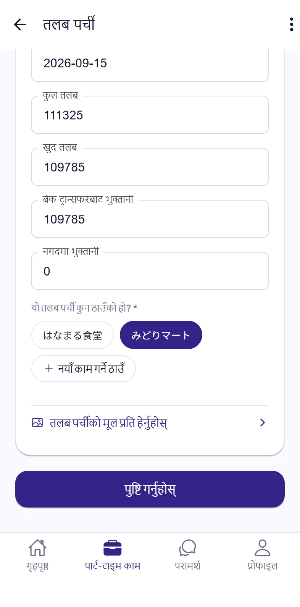
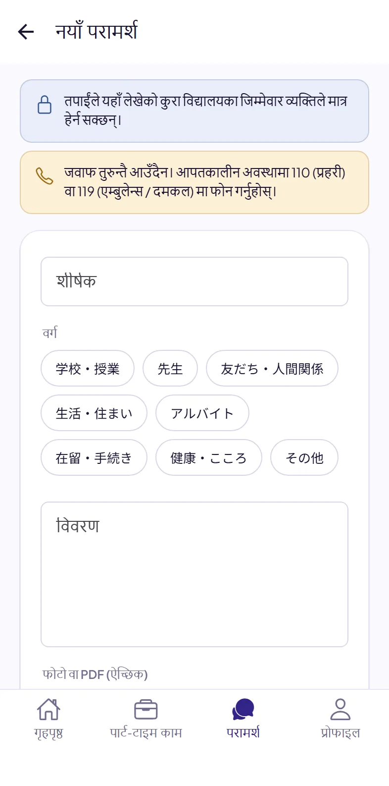
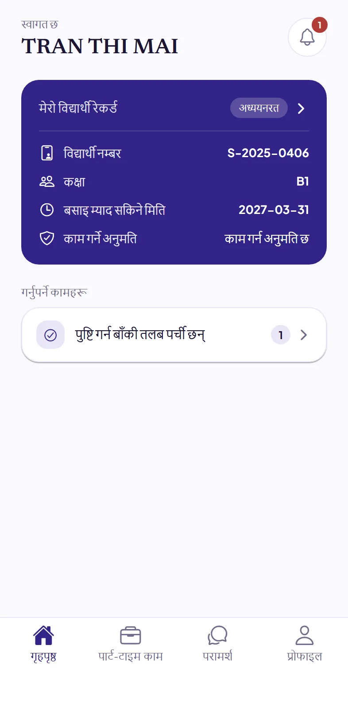

# Dignite Campus विद्यार्थी गाइड

- [Dignite Campus के हो](#dignite-campus-क-ह)
- [एप इन्स्टल गर्नुहोस्](#१-एप-इनसटल-गरनहस)
- [आफ्नो विद्यालयमा सहभागी हुनुहोस्](#२-आफन-वदयलयम-सहभग-हनहस)
- [हरेक दिन काम रेकर्ड गर्नुहोस्](#३-हरक-दन-कम-रकरड-गरनहस)
- [तलब पर्ची अपलोड गर्नुहोस्](#४-तलब-परच-अपलड-गरनहस)
- [विद्यालयसँग परामर्श गर्नुहोस्](#५-वदयलयसग-परमरश-गरनहस)
- [विद्यालयका सूचनाहरू](#६-वदयलयक-सचनहर)
- [समस्या परेमा](#समसय-परम)

## Dignite Campus के हो

Dignite Campus तपाईंको विद्यालयले प्रयोग गर्ने एप हो। यसमा तपाईं:

- हरेक दिन पार्ट-टाइम कामको समय रेकर्ड गर्न सक्नुहुन्छ
- तलब पर्ची अपलोड गर्न सक्नुहुन्छ
- विद्यालयसँग परामर्श गर्न सक्नुहुन्छ
- विद्यालयका सूचनाहरू पाउनुहुन्छ

## १. एप इन्स्टल गर्नुहोस्

App Store वा Google Play मा “Dignite Campus” खोजेर इन्स्टल गर्नुहोस्।

<!-- The App Store and Google Play badges go here once the app is in the stores. -->

एपले सूचना पठाउने अनुमति माग्दा अनुमति दिनुहोस्। यसो गरेमा मात्र तपाईंले विद्यालयको जवाफ, सूचना र काम रेकर्ड गर्ने सम्झना पाउनुहुन्छ।

## २. आफ्नो विद्यालयमा सहभागी हुनुहोस्

### पहिले यी तयार राख्नुहोस्

- **विद्यालयको कोड**: विद्यालयसँग सोध्नुहोस्।
- तलका दुईमध्ये एउटा:
  - विद्यालयले दिएको **लिङ्क कोड** र तपाईंको **जन्म मिति**
  - तपाईंको **विद्यार्थी नम्बर**, **जन्म मिति** र **रेसिडेन्स कार्ड नम्बर**

### चरणहरू

1. एप खोलेर **आफ्नो विद्यालयमा सहभागी हुनुहोस्** मा ट्याप गर्नुहोस्।
2. विद्यालयको कोड लेख्नुहोस्, प्रमाणित गर्ने तरिका छान्नुहोस्, अनि माथि तयार राखेका विवरण र आफ्नो इमेल ठेगाना लेख्नुहोस्। पछि तपाईं यही इमेल ठेगानाबाट लगइन गर्नुहुनेछ।
3. **प्रमाणित गरेर अगाडि बढ्नुहोस्** मा ट्याप गर्नुहोस्।
4. खुलेको पृष्ठमा खाता बनाउनुहोस्। पहिल्यै खाता छ भने सिधै लगइन गर्नुहोस्।
5. एपमा फर्केर **लगइन** मा ट्याप गर्नुहोस्।

“हामीले यी विवरण आफैँ प्रमाणित गर्न सकेनौं” देखिएमा विद्यालयसँग सम्पर्क गर्नुहोस्। विद्यालयले तपाईंलाई लिङ्क कोड दिनेछ, त्यसबाट सहभागी हुन सक्नुहुन्छ।

## ३. हरेक दिन काम रेकर्ड गर्नुहोस्

एपको तल **पार्ट-टाइम काम** मा ट्याप गर्नुहोस्, अनि **दैनिक रेकर्ड** मा ट्याप गर्नुहोस्।

### काम रेकर्ड गर्ने तरिका

1. **आजको काम रेकर्ड गर्नुहोस्** मा ट्याप गर्नुहोस्।
2. अघिल्लो पटक जस्तै भए **अघिल्लो पटक जस्तै** मा ट्याप गरेपछि रेकर्ड भइहाल्छ। फरक भए **काम थप्नुहोस्** मा ट्याप गर्नुहोस्।
3. काम गर्ने ठाउँ छान्नुहोस्। पहिलो पटक भने पहिले काम गर्ने ठाउँ थप्नुहोस्। एक पटक थपे पुग्छ।
4. सुरु समय, अन्त्य समय र विश्राम (मिनेट) भरेर **सेभ** मा ट्याप गर्नुहोस्।

- राति सुरु भएर भोलिपल्ट सकिने काम पनि एउटै रेकर्डमा भर्नुहोस्।
- काम थप्दा **पछिल्लो पटक जस्तै** मा ट्याप गरेर अघिल्लो पटकको विवरण भरेपछि सच्याउन पनि सकिन्छ।
- भर्न बिर्सेका दिनहरू पछि सूचीमा त्यो दिन ट्याप गरेर भर्न सकिन्छ।

**काम नगरेको दिन:** **आजको काम रेकर्ड गर्नुहोस्** मा ट्याप गरेपछि **आज मैले काम गरिनँ** मा ट्याप गर्नुहोस्।

**केही समय काम नगर्दा:** काम नपाउन्जेल, काम छाडेपछि वा घर फर्केको बेला **अहिले काम गरिरहेको छैन** खोल्नुहोस्। त्यसपछि दैनिक सम्झना आउँदैन। काम सुरु गरेपछि यसलाई बन्द गर्नुहोस्।

विद्यालयले तोकेको समयसम्म रेकर्ड नगरेमा एपले सम्झना गराउँछ। एपमा **आज** र **पछिल्ला ७ दिन** मा काम गरेको घण्टा र तपाईंलाई लागू हुने सीमा देख्न सकिन्छ।

## ४. तलब पर्ची अपलोड गर्नुहोस्

**पार्ट-टाइम काम** भित्र **तलब पर्ची** मा ट्याप गर्नुहोस्।

1. **तलब पर्ची अपलोड गर्नुहोस्** मा ट्याप गरेर **फोटो खिच्नुहोस्**, **फोटो छान्नुहोस्** वा **फाइल छान्नुहोस् (PDF)** छान्नुहोस्।
2. पहिलो पटक अपलोड गर्दा “AI ले तपाईंका कागजात पढ्ने” भन्ने व्याख्या देखिन्छ। पढेर **म सहमत छु, अगाडि बढ्नुहोस्** मा ट्याप गर्नुहोस्।
3. पढ्ने काम प्रायः केही मिनेटमै सकिन्छ। तलब पर्ची खोलेर मिति, घण्टा र रकम कागजको तलब पर्चीसँग मिलाउनुहोस्। गलत भएको ठाउँ सच्याउनुहोस्।
4. यो तलब पर्ची कुन काम गर्ने ठाउँको हो छानेर **पुष्टि गर्नुहोस्** मा ट्याप गर्नुहोस्।
5. त्यसपछि यो तलब जम्मा भएको देखिने **बैंक स्टेटमेन्टको स्क्रिनसट** अपलोड गर्नुहोस् (**बैंक स्टेटमेन्ट अपलोड गर्नुहोस्** मा ट्याप गर्नुहोस्)। जम्मा भएको भेटिएपछि “बैंक स्टेटमेन्टमा यो तलब जम्मा भएको भेटियो” देखिन्छ।

## ५. विद्यालयसँग परामर्श गर्नुहोस्

समस्या परेमा वा केही बुझ्न नसकेमा विद्यालयलाई भन्न सक्नुहुन्छ।

1. एपको तल **परामर्श** मा ट्याप गर्नुहोस्, अनि **नयाँ परामर्श** मा ट्याप गर्नुहोस्।
2. वर्ग छानेर शीर्षक र विवरण लेख्नुहोस्। तपाईंलाई सजिलो हुने जुनसुकै भाषामा लेख्न सक्नुहुन्छ। फोटो वा PDF पनि जोड्न सक्नुहुन्छ।
3. **पठाउनुहोस्** मा ट्याप गर्नुहोस्।

विद्यालयले जवाफ दिएपछि तपाईंलाई सूचना आउँछ। तपाईंले लेखेको कुरा विद्यालयका जिम्मेवार कर्मचारीले मात्र हेर्न सक्छन्।

> जवाफ तुरुन्तै आउँदैन। आपत्कालीन अवस्थामा **110** (प्रहरी) वा **119** (एम्बुलेन्स, दमकल) मा फोन गर्नुहोस्।

## ६. विद्यालयका सूचनाहरू

विद्यालयले पठाएका सूचना हेर्न गृहपृष्ठको माथि दायाँ कुनामा रहेको घण्टीमा ट्याप गर्नुहोस्। नयाँ सूचना आएमा फोनमा पनि जानकारी आउँछ।

## समस्या परेमा

- **विद्यालयको कोड थाहा छैन:** विद्यालयसँग सोध्नुहोस्।
- **लिङ्क कोडको म्याद सकियो वा चलेन:** विद्यालयसँग नयाँ लिङ्क कोड माग्नुहोस्।
- **नयाँ रेसिडेन्स कार्ड बन्यो:** विद्यालयलाई जानकारी दिनुहोस्।
- **सूचना आउँदैन:** फोनको सेटिङमा Dignite Campus लाई सूचना पठाउने अनुमति दिनुहोस्। Android फोनमा Dignite Campus को ब्याट्री प्रयोगमा कुनै प्रतिबन्ध नलगाउने विकल्प (Unrestricted) छान्नुहोस्।
