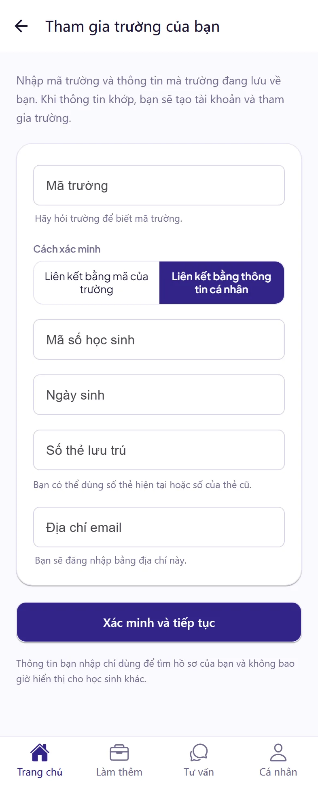
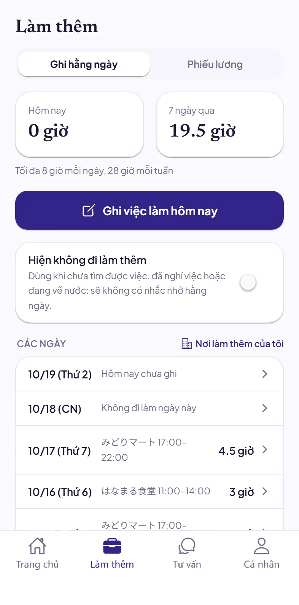
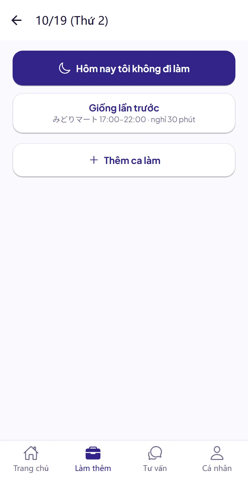
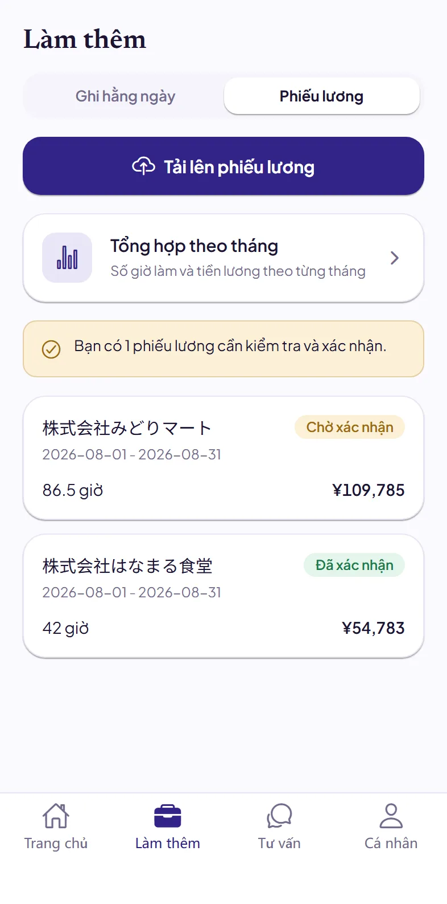
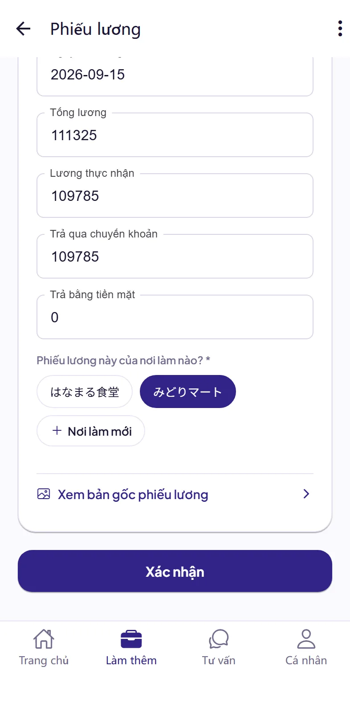
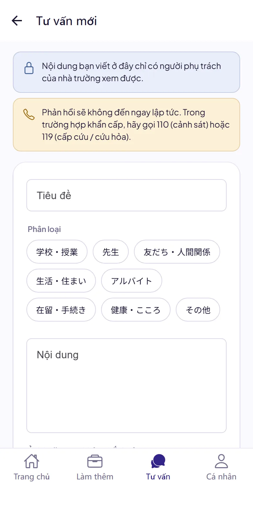
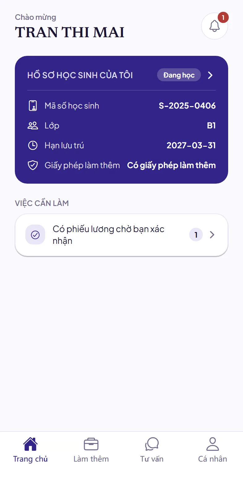

# Hướng dẫn dùng Dignite Campus cho học sinh

- [Dignite Campus là gì](#dignite-campus-là-gì)
- [Cài đặt ứng dụng](#1-cài-đặt-ứng-dụng)
- [Tham gia trường của bạn](#2-tham-gia-trường-của-bạn)
- [Ghi giờ làm thêm mỗi ngày](#3-ghi-giờ-làm-thêm-mỗi-ngày)
- [Tải lên phiếu lương](#4-tải-lên-phiếu-lương)
- [Tư vấn với trường](#5-tư-vấn-với-trường)
- [Thông báo của trường](#6-thông-báo-của-trường)
- [Khi gặp sự cố](#khi-gặp-sự-cố)

## Dignite Campus là gì

Dignite Campus là ứng dụng mà trường của bạn sử dụng. Với ứng dụng này, bạn có thể:

- Ghi lại giờ làm thêm mỗi ngày
- Tải lên phiếu lương
- Tư vấn với trường
- Nhận thông báo của trường

## 1. Cài đặt ứng dụng

Tìm “Dignite Campus” trên App Store hoặc Google Play và cài đặt. Bạn cũng có thể mở cửa hàng bằng liên kết bên dưới; nếu đang đọc hướng dẫn này trên máy tính, hãy dùng điện thoại quét mã QR.

| iPhone | Android |
|:---:|:---:|
| [Mở App Store](https://apps.apple.com/app/dignite-campus/id6824774968) | [Mở Google Play](https://play.google.com/store/apps/details?id=com.dignite.campus) |
|  |  |

Khi ứng dụng xin phép gửi thông báo, hãy chọn “Cho phép”. Như vậy bạn mới nhận được câu trả lời và thông báo của trường, cùng lời nhắc ghi giờ làm thêm.

## 2. Tham gia trường của bạn

### Chuẩn bị trước

- **Mã trường**: hãy hỏi trường.
- **Mã số học sinh**, **Ngày sinh** và **Số thẻ lưu trú** của bạn.

### Các bước

1. Mở ứng dụng, chạm vào **Tham gia trường của bạn**.
2. Nhập mã trường, chọn **Liên kết bằng thông tin cá nhân**, rồi nhập mã số học sinh, ngày sinh, số thẻ lưu trú và địa chỉ email của bạn. Sau này bạn sẽ đăng nhập bằng địa chỉ email này.
3. Chạm vào **Xác minh và tiếp tục**.
4. Tạo tài khoản trên trang vừa mở. Nếu đã có tài khoản, chỉ cần đăng nhập.
5. Quay lại ứng dụng, chạm vào **Đăng nhập**.

Bạn có thể tự xác minh bằng thông tin của mình, không cần nhờ trường. Nếu thấy “Chúng tôi không thể tự xác minh các thông tin này”, hãy liên hệ trường. Trường sẽ cấp cho bạn mã liên kết: chọn **Liên kết bằng mã của trường**, rồi nhập mã liên kết và ngày sinh để tham gia.

## 3. Ghi giờ làm thêm mỗi ngày

Ở phía dưới ứng dụng, chạm vào **Làm thêm**, rồi chạm vào **Ghi hằng ngày**.

### Ghi giờ làm

1. Chạm vào **Ghi việc làm hôm nay**.
2. Nếu giống lần trước, chỉ cần chạm vào **Giống lần trước** là xong. Nếu khác, chạm vào **Thêm ca làm**.
3. Chọn nơi làm thêm. Lần đầu, hãy thêm nơi làm thêm trước. Chỉ cần thêm một lần.
4. Nhập giờ bắt đầu, giờ kết thúc và thời gian nghỉ (phút), rồi chạm vào **Lưu**.

- Ca đêm kéo sang ngày hôm sau vẫn ghi thành một lần.
- Khi thêm ca làm, bạn cũng có thể chạm vào **Giống lần trước** để điền sẵn nội dung lần trước rồi sửa lại.
- Những ngày quên ghi, bạn có thể ghi bù sau bằng cách chạm vào ngày đó trong danh sách.

**Ngày không đi làm:** chạm vào **Ghi việc làm hôm nay**, rồi chạm vào **Hôm nay tôi không đi làm**.

**Khi tạm thời không đi làm:** lúc chưa tìm được việc, đã nghỉ việc hoặc đang về nước, hãy bật **Hiện không đi làm thêm**. Bạn sẽ không nhận lời nhắc hằng ngày nữa. Khi bắt đầu đi làm, hãy tắt đi.

Nếu đến giờ trường quy định mà bạn chưa ghi, ứng dụng sẽ nhắc bạn. Trong ứng dụng, bạn xem được số giờ đã làm **Hôm nay** và trong **7 ngày qua**, cùng giới hạn áp dụng cho bạn.

## 4. Tải lên phiếu lương

Trong **Làm thêm**, chạm vào **Phiếu lương**.

1. Chạm vào **Tải lên phiếu lương**, rồi chọn **Chụp ảnh**, **Chọn ảnh** hoặc **Chọn tệp (PDF)**.
2. Lần đầu tải lên, sẽ hiện phần giải thích “Dùng AI để đọc giấy tờ của bạn”. Hãy đọc rồi chạm vào **Tôi đồng ý và tiếp tục**.
3. Việc đọc thường xong trong vài phút. Mở phiếu lương, đối chiếu ngày, số giờ và số tiền với phiếu lương giấy. Chỗ nào sai thì sửa lại.
4. Chọn nơi làm thêm của phiếu lương này, rồi chạm vào **Xác nhận**.
5. Tiếp theo, hãy tải lên **ảnh chụp màn hình sao kê ngân hàng** có khoản lương này (chạm vào **Tải lên sao kê ngân hàng**). Khi tìm thấy khoản lương, sẽ hiện “Đã tìm thấy khoản lương này trong sao kê ngân hàng”.

## 5. Tư vấn với trường

Khi gặp khó khăn hoặc có điều chưa hiểu, bạn có thể nói với trường.

1. Ở phía dưới ứng dụng, chạm vào **Tư vấn**, rồi chạm vào **Tạo tư vấn mới**.
2. Chọn phân loại, điền tiêu đề và nội dung. Bạn có thể viết bằng bất kỳ ngôn ngữ nào. Cũng có thể đính kèm ảnh hoặc PDF.
3. Chạm vào **Gửi**.

Khi trường trả lời, bạn sẽ nhận được thông báo. Nội dung bạn viết chỉ người phụ trách của trường mới xem được.

> Câu trả lời không đến ngay. Khi khẩn cấp, hãy gọi **110** (cảnh sát) hoặc **119** (cấp cứu, cứu hỏa).

## 6. Thông báo của trường

Để xem thông báo của trường, chạm vào chuông ở góc trên bên phải của trang chủ. Khi có thông báo mới, điện thoại cũng sẽ báo cho bạn.

## Khi gặp sự cố

- **Không biết mã trường:** hãy hỏi trường.
- **Mã liên kết hết hạn hoặc không dùng được:** hãy nhờ trường cấp mã liên kết mới.
- **Đổi sang thẻ lưu trú mới:** hãy báo cho trường.
- **Không nhận được thông báo:** trong cài đặt của điện thoại, hãy cho phép Dignite Campus gửi thông báo. Với điện thoại Android, hãy đặt mức sử dụng pin của Dignite Campus thành “Không hạn chế”.
