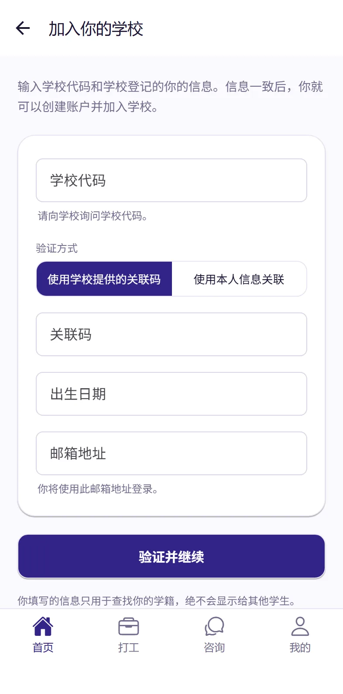
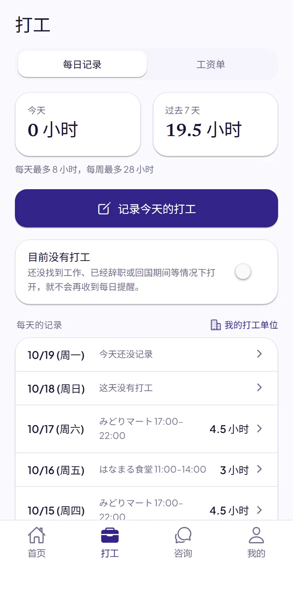
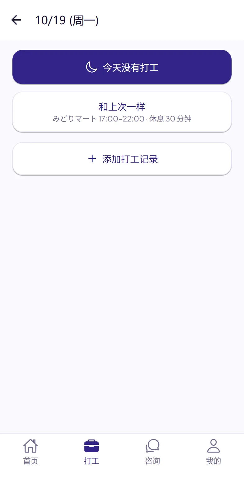
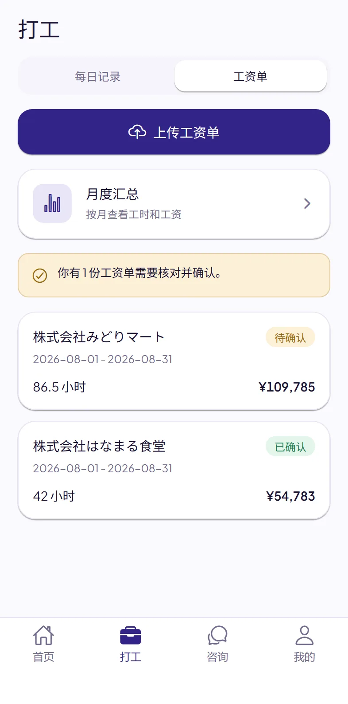
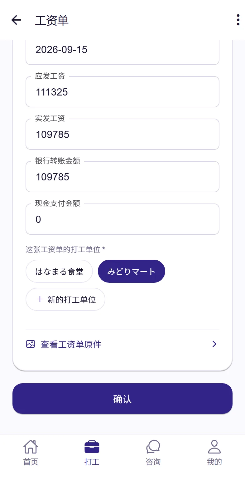
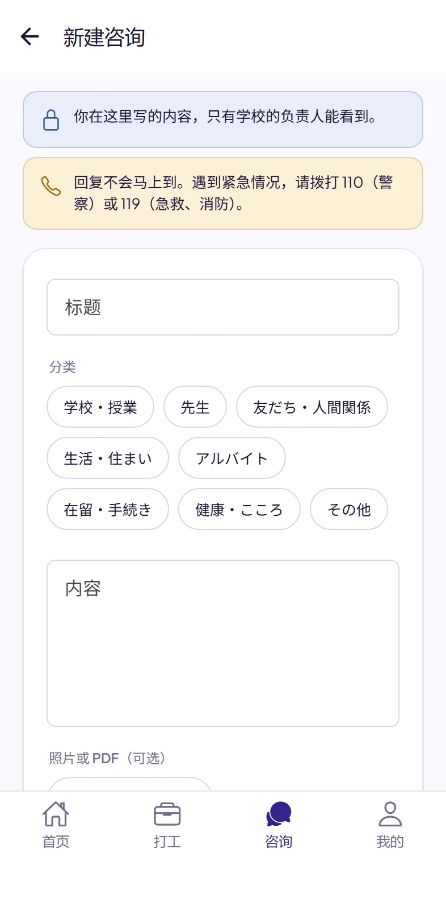
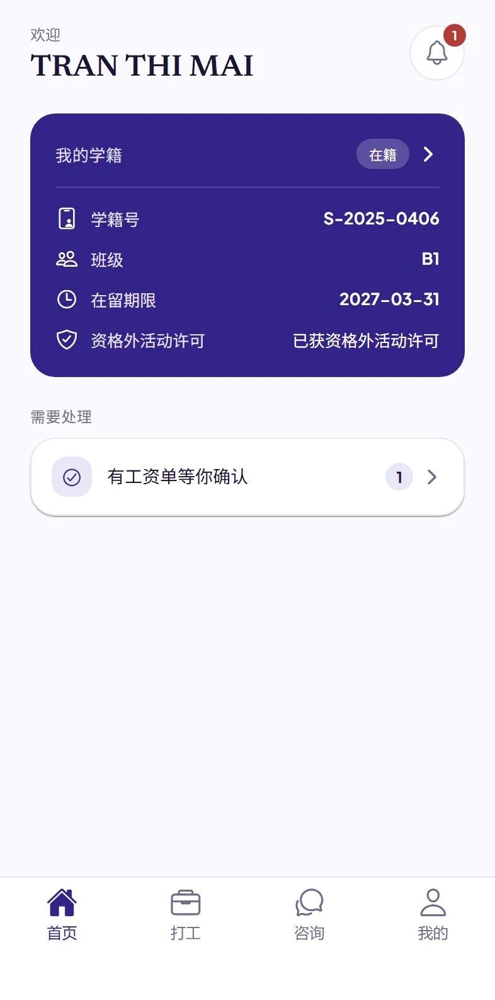

# Dignite Campus 学生使用指南

- [Dignite Campus 是什么](#dignite-campus-是什么)
- [安装 App](#1-安装-app)
- [加入你的学校](#2-加入你的学校)
- [每天记录打工](#3-每天记录打工)
- [上传工资单](#4-上传工资单)
- [向学校咨询](#5-向学校咨询)
- [学校的通知](#6-学校的通知)
- [遇到问题时](#遇到问题时)

## Dignite Campus 是什么

Dignite Campus 是你的学校使用的 App。用它可以：

- 每天记录打工的时间
- 上传工资单
- 向学校咨询
- 收到学校的通知

## 1. 安装 App

在 App Store 或 Google Play 搜索「Dignite Campus」并安装。

<!-- The App Store and Google Play badges go here once the app is in the stores. -->

App 请求发送通知时，请选择「允许」。这样你才能收到学校的回复、通知和打工记录的提醒。

## 2. 加入你的学校

### 先准备好

- **学校代码**：请向学校询问。
- 下面两种信息中的一种：
  - 学校给你的**关联码**，和你的**出生日期**
  - 你的**学籍号**、**出生日期**和**在留卡号**

### 步骤

1. 打开 App，点**加入你的学校**。
2. 输入学校代码，选择验证方式，再输入上面准备好的信息和你的邮箱地址。以后你用这个邮箱地址登录。
3. 点**验证并继续**。
4. 在打开的页面里创建账户。已经有账户的话，直接登录。
5. 回到 App，点**登录**。

如果显示「我们无法自动验证这些信息」，请联系学校。学校会给你一个关联码，用它就能加入。

## 3. 每天记录打工

在 App 下方点**打工**，再点**每日记录**。

### 记录打工

1. 点**记录今天的打工**。
2. 和上次一样的话，点**和上次一样**就记好了。不一样的话，点**添加打工记录**。
3. 选择打工单位。第一次请先添加打工单位，只需要添加一次。
4. 填写开始时间、结束时间和休息时间（分钟），点**保存**。

- 夜班跨到第二天也没关系，按一条记录填写。
- 添加打工记录时，也可以点**按上次填写**，先填好上次的内容再修改。
- 忘记填写的日子，之后也可以在列表里点那一天补上。

**没有打工的日子**：点**记录今天的打工**后，再点**今天没有打工**。

**暂时不打工时**：还没找到工作、已经辞职或回国期间，请打开**目前没有打工**，就不会再收到每天的提醒。开始打工时请关掉它。

如果到了学校设定的时间还没有记录，App 会提醒你。App 上可以看到**今天**和**过去 7 天**打工的小时数，以及适用的上限。

## 4. 上传工资单

在**打工**里点**工资单**。

1. 点**上传工资单**，选择**拍照**、**从相册选择**或**选择文件（PDF）**。
2. 第一次上传时，会显示「用 AI 读取你的资料」的说明。请阅读后点**同意并继续**。
3. 识别通常几分钟就会完成。打开工资单，对照纸质工资单核对日期、工时和金额，不对的地方请改正。
4. 选择这张工资单的打工单位，点**确认**。
5. 接着请上传能看到这笔工资入账的**银行流水截图**（点**上传银行流水**）。找到入账后，会显示「已在银行流水中找到这笔工资的入账」。

## 5. 向学校咨询

遇到困难或有不明白的地方，可以告诉学校。

1. 在 App 下方点**咨询**，再点**新建咨询**。
2. 选择分类，填写标题和内容。用你习惯的语言写就可以。也可以附上照片或 PDF。
3. 点**发送**。

学校回复后，你会收到通知。你写的内容，只有学校的负责人能看到。

> 回复不会马上到。遇到紧急情况，请拨打 **110**（警察）或 **119**（急救、消防）。

## 6. 学校的通知

学校发来的通知，可以点首页右上角的铃铛查看。有新通知时，手机也会收到提醒。

## 遇到问题时

- **不知道学校代码**：请问学校。
- **关联码过期了，或者用不了**：请学校重新给你一个关联码。
- **换了新的在留卡**：请告诉学校。
- **收不到通知**：请在手机的设置里允许 Dignite Campus 发送通知。安卓手机还请把 Dignite Campus 的电池使用设为「不受限制」。
