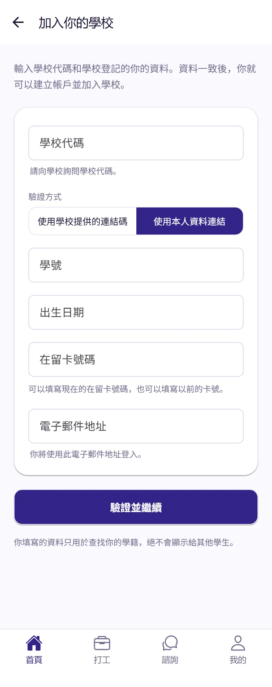
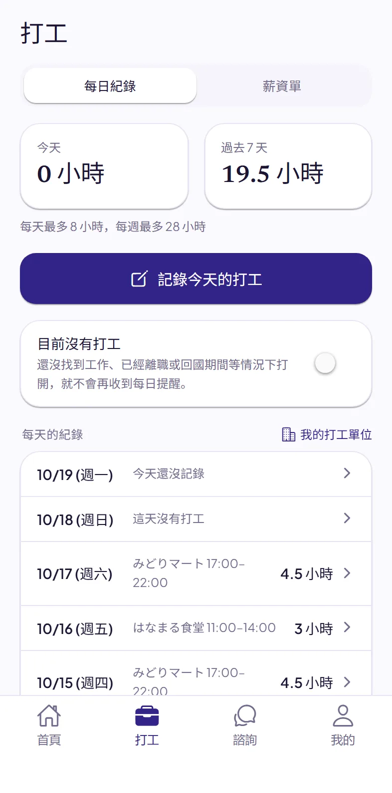
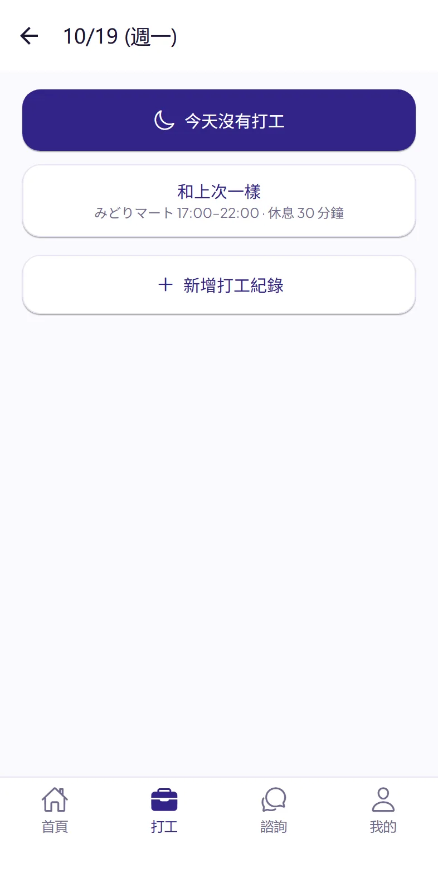
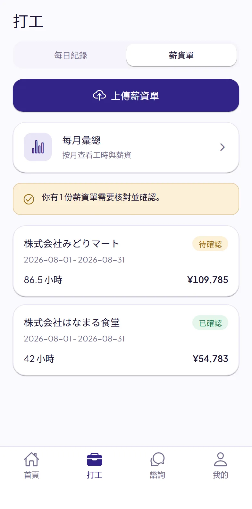
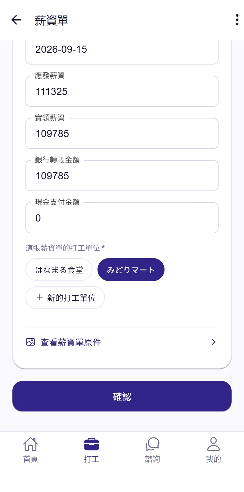
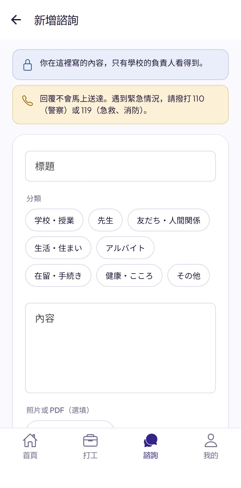
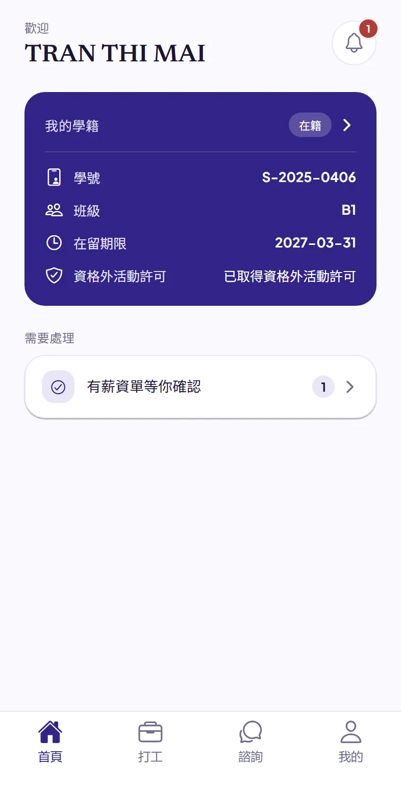

# Dignite Campus 學生使用指南

- [Dignite Campus 是什麼](#dignite-campus-是什麼)
- [安裝 App](#1-安裝-app)
- [加入你的學校](#2-加入你的學校)
- [每天記錄打工](#3-每天記錄打工)
- [上傳薪資單](#4-上傳薪資單)
- [向學校諮詢](#5-向學校諮詢)
- [學校的通知](#6-學校的通知)
- [遇到問題時](#遇到問題時)

## Dignite Campus 是什麼

Dignite Campus 是你的學校使用的 App。用它可以：

- 每天記錄打工的時間
- 上傳薪資單
- 向學校諮詢
- 收到學校的通知

## 1. 安裝 App

在 App Store 或 Google Play 搜尋「Dignite Campus」並安裝。也可以點下面的連結直接開啟商店；如果你在電腦上看這份手冊，用手機掃描 QR 碼。

| iPhone | Android |
|:---:|:---:|
| [開啟 App Store](https://apps.apple.com/app/dignite-campus/id6824774968) | [開啟 Google Play](https://play.google.com/store/apps/details?id=com.dignite.campus) |
|  |  |

App 要求傳送通知時，請選擇「允許」。這樣你才能收到學校的回覆、通知和打工紀錄的提醒。

## 2. 加入你的學校

### 先準備好

- **學校代碼**：請向學校詢問。
- 下面兩種資料中的一種：
  - 學校給你的**連結碼**，和你的**出生日期**
  - 你的**學號**、**出生日期**和**在留卡號碼**

### 步驟

1. 打開 App，點**加入你的學校**。
2. 輸入學校代碼，選擇驗證方式，再輸入上面準備好的資料和你的電子郵件地址。以後你用這個電子郵件地址登入。
3. 點**驗證並繼續**。
4. 在開啟的頁面裡建立帳戶。已經有帳戶的話，直接登入。
5. 回到 App，點**登入**。

如果顯示「我們無法自動驗證這些資料」，請聯絡學校。學校會給你一組連結碼，用它就能加入。

## 3. 每天記錄打工

在 App 下方點**打工**，再點**每日紀錄**。

### 記錄打工

1. 點**記錄今天的打工**。
2. 和上次一樣的話，點**和上次一樣**就記好了。不一樣的話，點**新增打工紀錄**。
3. 選擇打工單位。第一次請先新增打工單位，只需要新增一次。
4. 填寫開始時間、結束時間和休息時間（分鐘），點**儲存**。

- 夜班跨到隔天也沒關係，按一筆紀錄填寫。
- 新增打工紀錄時，也可以點**按上次填寫**，先填好上次的內容再修改。
- 忘記填寫的日子，之後也可以在列表裡點那一天補上。

**沒有打工的日子**：點**記錄今天的打工**後，再點**今天沒有打工**。

**暫時不打工時**：還沒找到工作、已經離職或回國期間，請打開**目前沒有打工**，就不會再收到每天的提醒。開始打工時請關掉它。

如果到了學校設定的時間還沒有記錄，App 會提醒你。App 上可以看到**今天**和**過去 7 天**打工的時數，以及適用的上限。

## 4. 上傳薪資單

在**打工**裡點**薪資單**。

1. 點**上傳薪資單**，選擇**拍照**、**從相簿選擇**或**選擇檔案（PDF）**。
2. 第一次上傳時，會顯示「用 AI 讀取你的資料」的說明。請閱讀後點**同意並繼續**。
3. 辨識通常幾分鐘就會完成。打開薪資單，對照紙本薪資單核對日期、工時和金額，不對的地方請改正。
4. 選擇這張薪資單的打工單位，點**確認**。
5. 接著請上傳能看到這筆薪資入帳的**銀行交易明細截圖**（點**上傳銀行交易明細**）。找到入帳後，會顯示「已在銀行交易明細中找到這筆薪資的入帳」。

## 5. 向學校諮詢

遇到困難或有不明白的地方，可以告訴學校。

1. 在 App 下方點**諮詢**，再點**新增諮詢**。
2. 選擇分類，填寫標題和內容。用你習慣的語言寫就可以。也可以附上照片或 PDF。
3. 點**送出**。

學校回覆後，你會收到通知。你寫的內容，只有學校的負責人能看到。

> 回覆不會馬上到。遇到緊急情況，請撥打 **110**（警察）或 **119**（救護車、消防）。

## 6. 學校的通知

學校發來的通知，可以點首頁右上角的鈴鐺查看。有新通知時，手機也會收到提醒。

## 遇到問題時

- **不知道學校代碼**：請問學校。
- **連結碼過期了，或者用不了**：請學校重新給你一組連結碼。
- **換了新的在留卡**：請告訴學校。
- **收不到通知**：請在手機的設定裡允許 Dignite Campus 傳送通知。Android 手機還請把 Dignite Campus 的電池用量設為「不受限制」。
