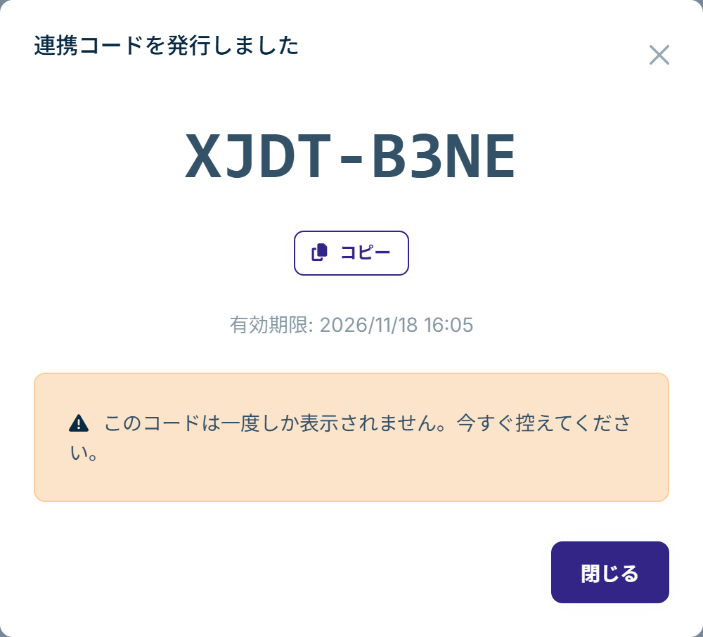
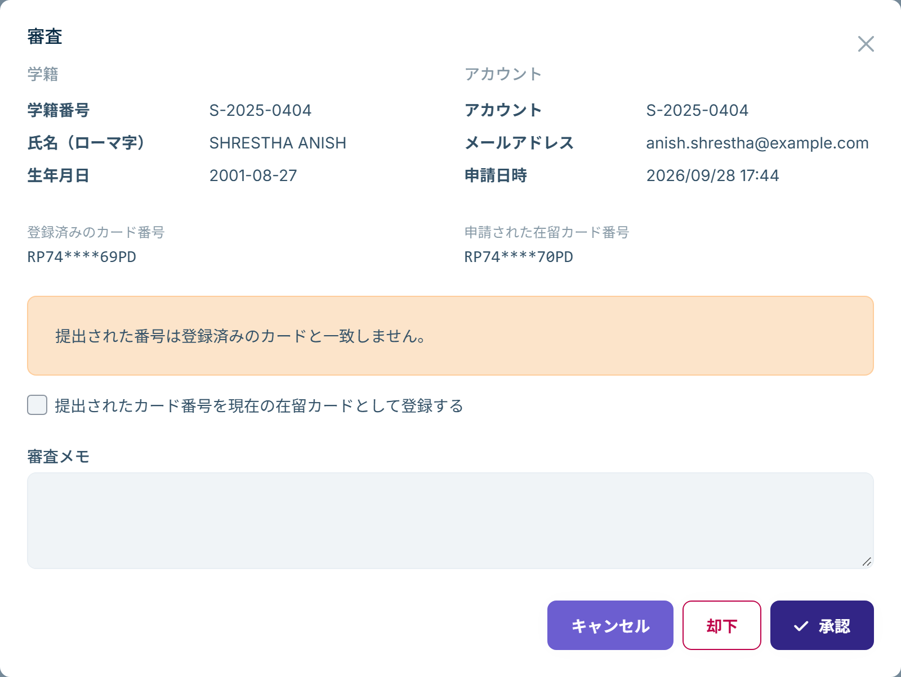

# 学生のアプリ参加と学籍の連携

学生は、学生用アプリで学校に参加すると、自分の学籍とつながります。これを**連携**といいます。連携した学生は、アプリでアルバイトの記録、給与明細の提出、学校への相談ができ、お知らせも受け取れます。

学校に参加できるのは、学籍が登録されている学生だけです。先に[学籍を登録](students.md)してから、学生に参加してもらってください。

## 学生に伝えること

学生がアプリで学校に参加するには、次の情報が必要です。

- **学校コード**：トライアルの申し込みのときに決めたコードです。ホーム画面の「Campus を始める」でコピーできます。
- **本人を確認する情報**：次のどちらかです。
  - 学校が発行した**連携コード**と、生年月日
  - **学籍番号**、生年月日、**在留カード番号**

学籍番号・生年月日・在留カード番号が学籍に正しく登録されていれば、連携コードを配らなくても、学生は自分で参加できます。在留カード番号は、現在のカードでも以前のカードでもかまいません。

## 学生がアプリで行うこと

1. アプリで「学校に参加する」を開きます。
2. 学校コード、確認方法と確認の情報、メールアドレスを入力して「確認して進む」を押します。
3. 開いたページで、アカウントを作成します（すでにアカウントがある場合はログインします）。
4. アプリに戻ってログインします。

情報が学籍と一致すると、学生は学校に参加し、学籍との連携も完了します。管理画面での作業は必要ありません。

アプリで入力したメールアドレスは、学生がログインに使うアドレスです。学籍に登録したメールアドレスと違っていてもかまいません。

### 参加できなかった場合

| アプリの表示 | 学校の対応 |
|---|---|
| 学校コードが正しくないか、現在この学校はご利用いただけません。 | 学校コードを伝え直してください |
| 入力した情報に一致する学籍が、この学校には見つかりませんでした。 | 学籍番号・生年月日が学籍の登録内容と合っているか確認してください |
| これらの情報だけでは確認できませんでした。学校にお問い合わせください。 | 連携コードを発行して学生に渡してください（下記） |
| 試行回数が多すぎます。しばらくしてからもう一度お試しください。 | 何度も間違えた場合です。30 分ほど待ってから試すよう伝えてください |

「これらの情報だけでは確認できませんでした」は、学籍番号と生年月日は合っているのに在留カード番号が登録と違う場合や、その学籍がすでに別のアカウントと連携している場合に表示されます。在留カードが新しくなっている場合は、学籍に[新しい在留カードを登録](students.md)すると、学生は自分で参加できるようになります。

## 連携コードを発行する

連携コードは、一人の学生だけが一度だけ使えるコードです。在留カード番号で確認できない学生や、すぐに確実に参加してほしい学生に発行します。

1. 学生の詳細で「アカウント連携」タブを開きます。
2. 「連携コード発行」を押します。
3. `XXXX-XXXX` の形式の連携コードと、有効期限が表示されます。「コピー」を押すか書き写して、学生に渡します。

- 連携コードは**この画面で一度しか表示されません**。閉じた後に確認することはできないため、必要になったら発行し直してください。
- 発行し直すと、以前に発行したコードは使えなくなります。
- 有効期限は発行から 30 日です。
- 配った連携コードを使えなくするには、「コード無効化」を押します。

## 連携の状況を確認する

- 学籍一覧の「連携状況」列に、連携済みか未連携かが表示されます。上部の「アカウント連携」で、未連携の学生だけを絞り込めます。
- 学生の詳細の「アカウント連携」タブには、連携しているアカウント、連携日時、連携方法（連携コード・自己照合・手動）が表示されます。

## 連携を解除する

学生が別のアカウントで参加し直したい場合などは、「アカウント連携」タブの「連携解除」を押します。解除すると、その学生は再び連携するまでアプリを使えなくなります。学籍と、学生が記録したアルバイトや給与明細は学籍に残ります。

## アカウント連携申請を審査する

学校に参加した後、アプリの「学籍と連携する」→「本人情報で連携」で、学籍番号と生年月日は合っているのに在留カード番号が登録と違った場合、学校への**連携申請**になります。左のメニューの「学籍管理」→「アカウント連携申請」に届きます。

1. 一覧で申請の「審査」を押します。
2. 学籍の情報、学生のアカウント、登録済みのカード番号と、申請された在留カード番号を見比べます。
3. 内容に問題がなければ「承認」、学生本人でなければ「却下」を押します。審査メモを残すこともできます。

申請された番号が新しい在留カードのものであれば、「提出されたカード番号を現在の在留カードとして登録する」を選び、在留期間、在留期間の満了日、交付年月日を入力してから承認します。承認と同時に、新しいカードが学籍に登録されます。
