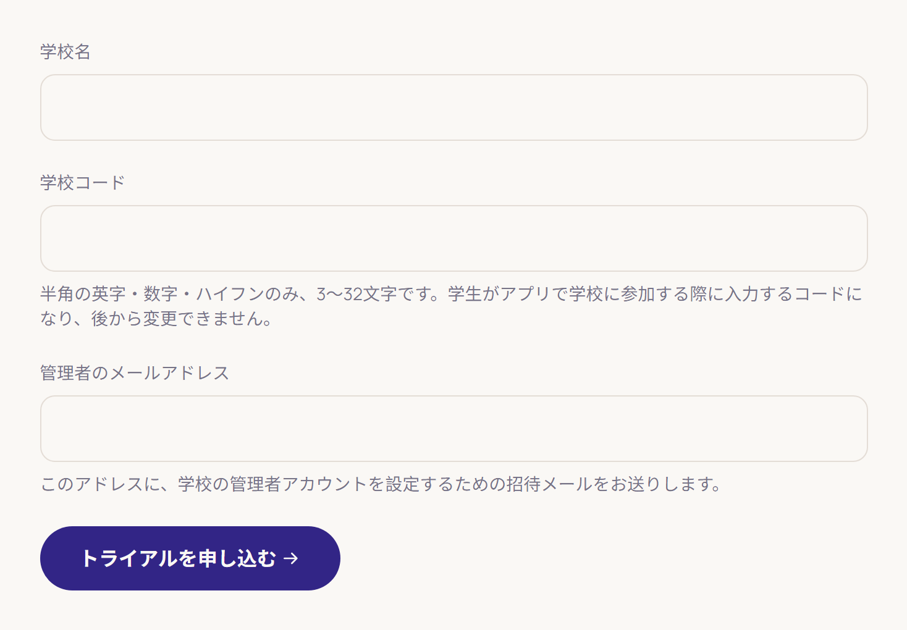
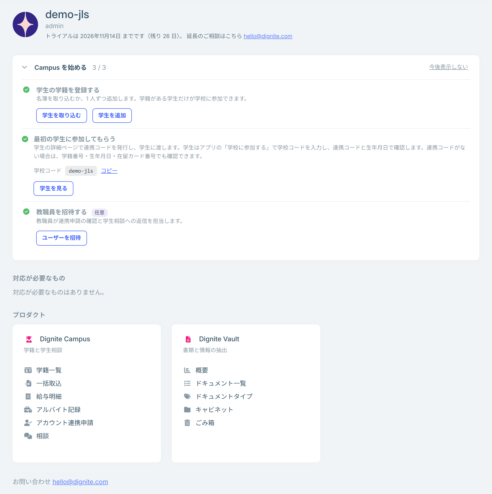

# トライアルの申し込みと最初のログイン

Dignite Campus は、ウェブサイトから申し込むとすぐに使い始められます。トライアル期間は 30 日間です。

## トライアルを申し込む

1. [無料トライアルのページ](https://dignite.com/ja/dignite-campus/trial)を開きます。
2. 次の 3 つを入力し、「トライアルを申し込む」を押します。
   - **学校名**
   - **学校コード**：学校を表す短いコードです。半角の英字・数字・ハイフンで、3〜32 文字にします。
   - **管理者のメールアドレス**：学校の管理者になる方のメールアドレスです。
3. 「お申し込みありがとうございます」と表示されたら、申し込みは完了です。入力したメールアドレスに招待メールが届きます。

### 学校コードについて

学校コードは、学生がアプリで学校に参加するときに入力するコードです。後から変更できないため、学生に伝えやすく、学校がわかるものにしてください（例：`example-jls`）。

- 大文字と小文字は区別しません。
- すでに使われているコードや、予約されているコードは使えません。その場合は画面に表示されるので、別のコードを指定してください。

## 招待メールから管理者アカウントを設定する

件名が「【DIGNITE】「学校コード」へのご招待」のメールが届きます。メール内のリンクは送信から 7 日間有効です。

- **初めて DIGNITE を使う場合**：「アカウントを登録して参加する」を押し、表示された画面でユーザー名とパスワードを決めて登録します。メールアドレスは招待されたアドレスが入っています。「テナント「学校コード」に参加しました。」と表示されたら登録は完了です。
- **すでに DIGNITE のアカウントがある場合**：「招待を承諾する」を押します。招待メールが届いたメールアドレスで登録済みのアカウントを使います。

ボタンが機能しない場合は、メールに記載されている URL をブラウザのアドレスバーに貼り付けて開いてください。

招待メールが届かない場合や、リンクの有効期限が切れた場合は、[お問い合わせ](https://dignite.com/ja/contact)から再送をご依頼ください。

## 管理画面にログインする

1. [https://console.dignite.com](https://console.dignite.com) を開き、「ログイン」を押します。
2. ログイン画面で、登録したアカウントのメールアドレス（またはユーザー名）とパスワードを入力します。

アカウントの登録だけではログインした状態にならないため、登録が終わったらこの手順でログインしてください。一つのアカウントで複数の学校に参加している場合は、ログインのときに学校を選ぶ画面が表示されます。

## ホーム画面

ログインすると、ホーム画面が表示されます。

- **Campus を始める**：最初にすることが順に並んでいます。学生の学籍の登録、最初の学生の参加、教職員の招待です。学校コードもここでコピーできます。不要になったら「今後表示しない」を押します。
- **対応が必要なもの**：未読の通知、返信待ちの学生相談、確認待ちの学生連携申請などの件数です。押すとそれぞれの画面が開きます。
- **トライアルの残り日数**：トライアル期間の終了日と残り日数です。

左のメニューの「学籍管理」と「学生支援」から、それぞれの画面を開きます。メニューには、自分のロールで使える画面だけが表示されます。

## トライアル期間が終わったら

トライアル期間が終わると、管理画面と学生用アプリは使えなくなりますが、データは保持されます。継続をご希望の場合は、[お問い合わせ](https://dignite.com/ja/contact)ください。

## 次にすること

- [職員の招待とロール](staff-and-roles.md)
- [学籍の登録と管理](students.md)
