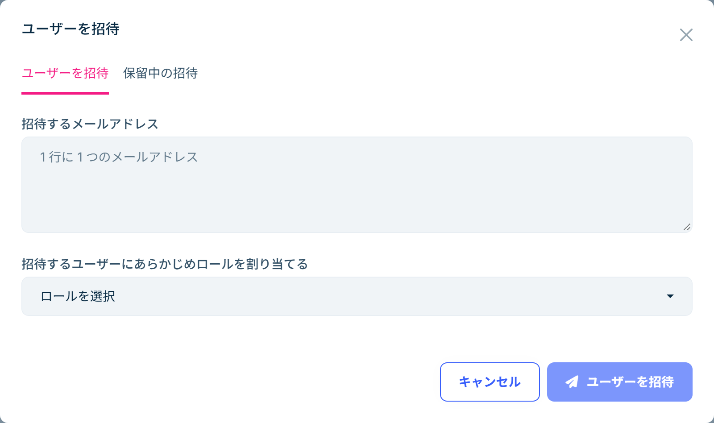

# 職員の招待とロール

職員は、管理者からの招待メールでアカウントを作り、管理画面にログインします。管理画面でどの画面を使えるかは、職員に割り当てた**ロール**で決まります。

## ロール

学校には、最初から次のロールがあります。一人に複数のロールを割り当てることもできます。

| ロール | 使える機能 |
|---|---|
| `admin` | すべての機能。トライアルを申し込んだ管理者には、このロールが割り当てられています |
| `staff` | 学籍の閲覧・登録・編集・在籍状態の変更・一括取込、アプリ連携の管理と連携申請の審査、給与明細とアルバイト記録の閲覧・エクスポート |
| `support` | 学生からの相談の閲覧・回答、相談分類の管理、学生へのお知らせの配信 |
| `student` | 学生用のロールです。学生はアプリで学校に参加するとこのロールになるため、職員には割り当てません |

`staff` では、次の操作はできません。必要な職員には、`admin` を割り当てるか、ロールの権限を変更してください。

- 学籍の削除
- アルバイト記録の設定（リマインダー時刻・長期休業期間）

相談は個人的な内容を含むことが多いため、`staff` と `support` を分けています。相談を担当する職員にだけ `support` を割り当ててください。

## 職員を招待する

1. 左のメニューの「管理」→「ID 管理」→「ユーザー」を開きます。
2. 「新しいユーザー」の右にある ▼ を押し、「ユーザーを招待」を選びます。
3. 「招待するメールアドレス」に職員のメールアドレスを入力します。1 行に 1 つずつ入力すると、複数の職員をまとめて招待できます。
4. 「招待するユーザーにあらかじめロールを割り当てる」で、`staff` や `support` を選びます。ここで選べるロールは一つです。まとめて招待した職員には同じロールが割り当てられるので、ロールが違う職員は分けて招待してください。複数のロールが必要な職員には、参加した後に下の「職員のロールを変更する」の手順でロールを追加します。
5. 「ユーザーを招待」を押すと、職員に招待メールが届きます。

職員は、[管理者の場合](getting-started.md)と同じように、招待メールからアカウントを登録し、[https://console.dignite.com](https://console.dignite.com) にログインします。招待メールのリンクは送信から 7 日間有効です。

### 招待の再送と取り消し

まだ承諾されていない招待は、同じダイアログの「保留中の招待」タブに表示されます。各行の「操作」から「招待を再送信」または「招待を取り消す」ができます。リンクの有効期限が切れた場合は、再送信してください。

## 職員のロールを変更する

1. 「管理」→「ID 管理」→「ユーザー」で、対象の職員の「操作」→「編集」を開きます。
2. 「ロール」で、割り当てるロールを選び直して保存します。

職員が退職した場合は、「ユーザー」の一覧で対象の職員の「操作」→「テナントから外す」を選ぶと、その職員はこの学校の管理画面に入れなくなります。休職中などで一時的に止めたいときは、「編集」で「有効」のチェックを外すか、ロールを外してください。

## ロールの権限を変更する

ロールでできることは、権限で決まっています。学校の運用に合わせて変更できます。

1. 「管理」→「ID 管理」→「ロール」で、対象のロールの「操作」→「権限」を開きます。
2. 「学籍管理」と「学生支援」の中の権限を選び、保存します。

| グループ | 権限 |
|---|---|
| 学籍管理 | 学籍（新規作成・編集・削除・在籍状態の変更・一括取込・アカウント連携の管理）、アカウント連携申請（審査）、給与明細（エクスポート）、アルバイト記録（エクスポート・設定（リマインダー・休業期間）） |
| 学生支援 | 相談の閲覧・回答、相談分類の管理、学生へのお知らせ配信 |

権限を変更すると、そのロールを持つすべての職員に反映されます。変更後に画面に反映されない場合は、職員にログインし直してもらってください。

## 通知

学生から相談のメッセージが届くと、「相談の閲覧・回答」の権限を持つ職員の管理画面に通知が届きます。画面上部のベルのアイコンを押すと通知の一覧が開き、通知を押すとその相談が開きます。
