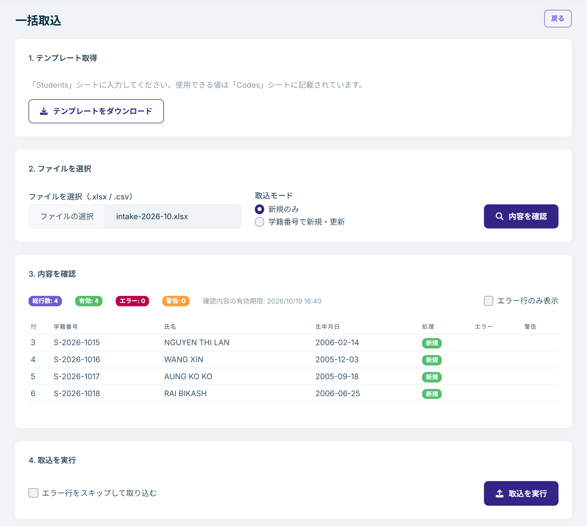

# 学籍の一括取込

学生の名簿を Excel（.xlsx）または CSV で取り込み、学籍をまとめて登録・更新できます。取り込む前に内容を確認でき、エラーのある行は画面に表示されます。

学籍一覧の「取込」を押すと、取込の画面が開きます。画面は 4 つの手順に分かれています。

## 1. テンプレート取得

「テンプレートをダウンロード」を押して、Excel のテンプレートを入手します。

- 学生の情報は「Students」シートに、1 行に 1 人ずつ入力します。
- 在籍状態や入学時期など、決まった値から選ぶ列に使える値は、「Codes」シートに記載されています。英語の値（例：`April`）のほか、日本語の表記（例：`4月期`、`在籍`、`2年`）でも入力できます。
- 資格外活動許可の列は、`有`・`無`（`はい`・`いいえ`、`TRUE`・`FALSE` も可）で入力します。
- 1 行目の見出しは変更しないでください。認識できない見出しの列は無視されます。

必須の列は、手で登録するときと同じく、学籍番号、氏名（ローマ字）、生年月日、国籍・地域、入学時期、修業期間です。

- 日付は、Excel の日付のセルのほか、`2026-04-01`、`2026/4/1`、`2026年4月1日` のような年・月・日の順の書き方で入力できます。
- 国籍・地域は 2 文字の国コード（例：`VN`、`NP`、`CN`）で入力します。
- 在留カード番号を入力する場合は、在留期間の満了日も入力します。

## 2. ファイルを選択

1. 「ファイルを選択（.xlsx / .csv）」で、入力したファイルを選びます。
   - CSV は、Excel の「名前を付けて保存」で「CSV UTF-8（コンマ区切り）」か「CSV（コンマ区切り）」を選んで保存したものを使ってください。Google スプレッドシートなどほかのソフトで書き出した CSV は、「ヘッダー行が見つかりません。」と表示されて読み込めないことがあります。その場合は .xlsx で保存して取り込んでください。
2. 「取込モード」を選びます。
   - **新規のみ**：新しい学生だけを登録します。すでに登録されている学籍番号の行はエラーになります。
   - **学籍番号で新規・更新**：登録されていない学籍番号の行は新規登録し、登録されている学籍番号の行はその学籍を更新します。
3. 「内容を確認」を押します。

## 3. 内容を確認

ファイルの内容が行ごとに表示されます。この時点では、まだ何も登録されていません。

- **総行数・有効・エラー・警告**：行の件数です。
- **処理**：その行が新規か、更新か、スキップかです。
- **エラー**：取り込めない理由です。例えば、必須の項目が空、日付の形式が違う、学籍番号がファイル内で重複している、などです。
- **警告**：取り込みはできますが、確認してほしい点です。例えば、認識できない列は無視されます。

「エラー行のみ表示」を選ぶと、直す必要のある行だけを確認できます。エラーがあれば、ファイルを直して手順 2 からやり直してください。

確認した内容には有効期限があります（「確認内容の有効期限」に表示）。期限が切れたら、ファイルをもう一度選んでください。

## 4. 取込を実行

「取込を実行」を押すと、学籍が登録・更新されます。

- エラーのある行が残っている場合は、「エラー行をスキップして取り込む」を選ぶと、エラーのない行だけを取り込めます。
- 結果には、新規・更新・スキップ・失敗の件数が表示されます。
- 続けて別のファイルを取り込むときは「別のファイルを取り込む」を押します。

## 更新するときのルール

「学籍番号で新規・更新」で既存の学籍を更新する場合：

- **値が入っているセルだけが反映されます。** 空のセルは、登録済みの内容をそのまま残します。一部の列だけを入れたファイルで、特定の項目だけを更新できます。
- **在籍状態は変わりません。** 既存の学生の在籍状態は、取込では変更されません。学籍の詳細の「状態変更」で変更してください。新規の学生の場合は、在籍状態の列がその学生の初期在籍状態になります（空なら「入学予定」）。
- **在留カード**：登録済みのカードと違う番号が入っていると、新しいカードとして登録され、現在有効なカードになります。同じ番号の場合は何も変わりません。
  - 新しいカードは、その行に入っている値だけで登録されます。以前のカードの内容は引き継がれません。特に**資格外活動許可の列が空だと「許可なし」で登録され**、その学生にはアルバイト記録のリマインダーが届かなくなり、記録のない月はアルバイト記録の一覧にも表示されません。新しいカードを取り込むときは、在留期間の満了日のほか、資格外活動許可とその種類の列も入れてください。

## 取り込めない学籍番号

次の学籍番号はエラーになります。

- ファイル内で重複している学籍番号
- 「新規のみ」で、すでに登録されている学籍番号
- 削除した学籍で使われていた学籍番号
