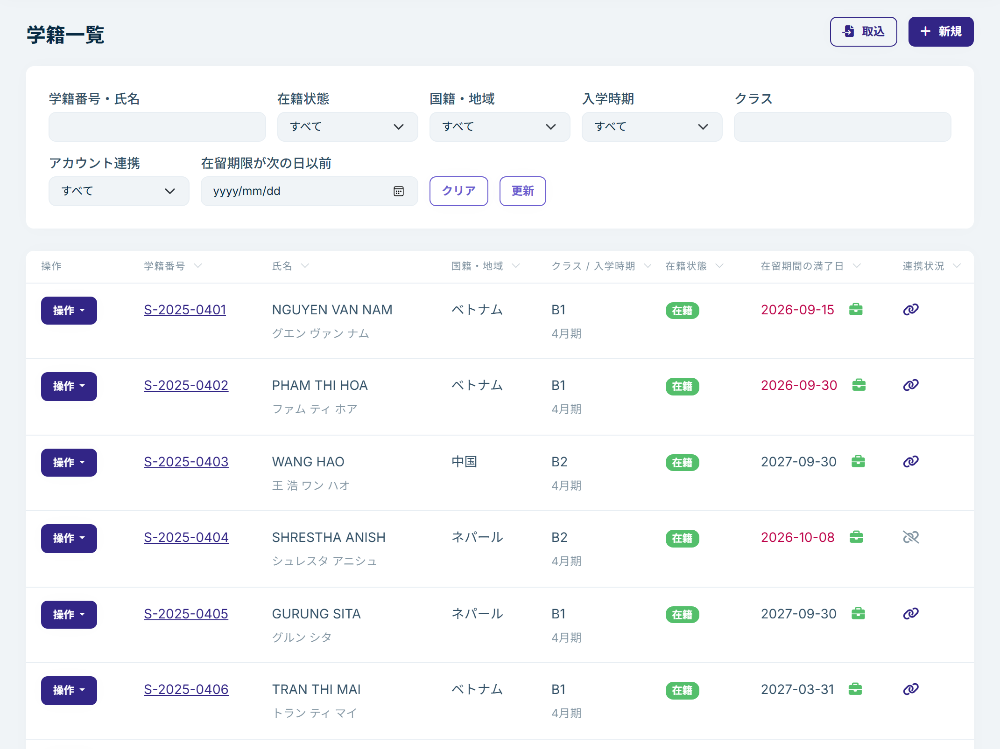
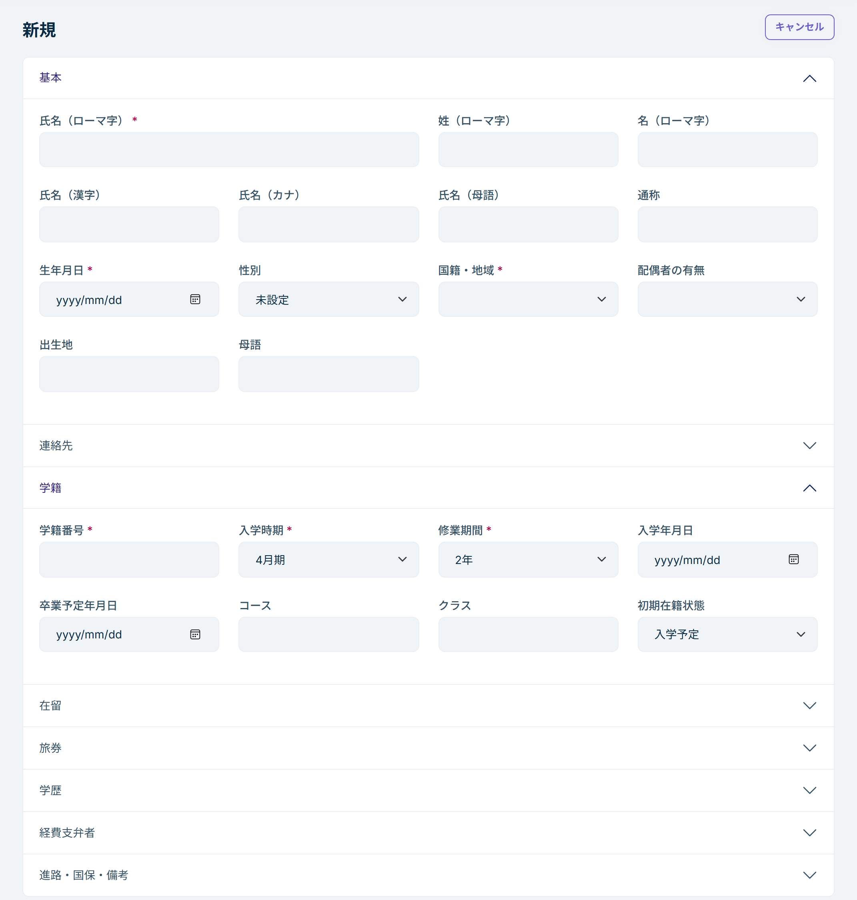
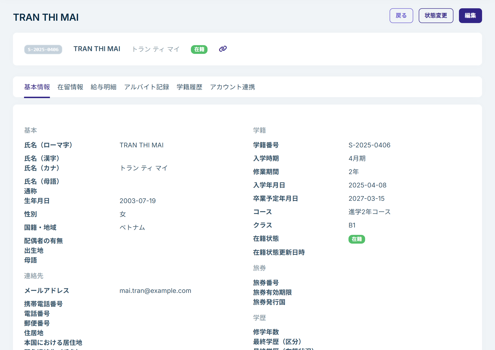
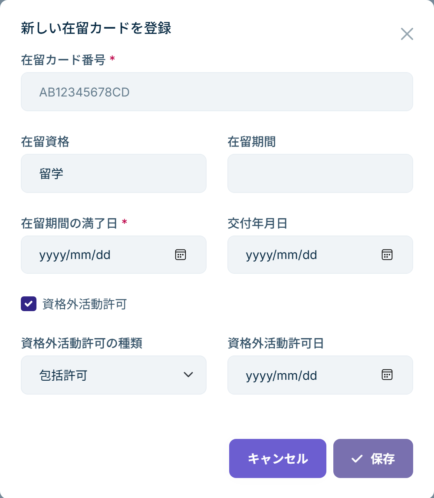
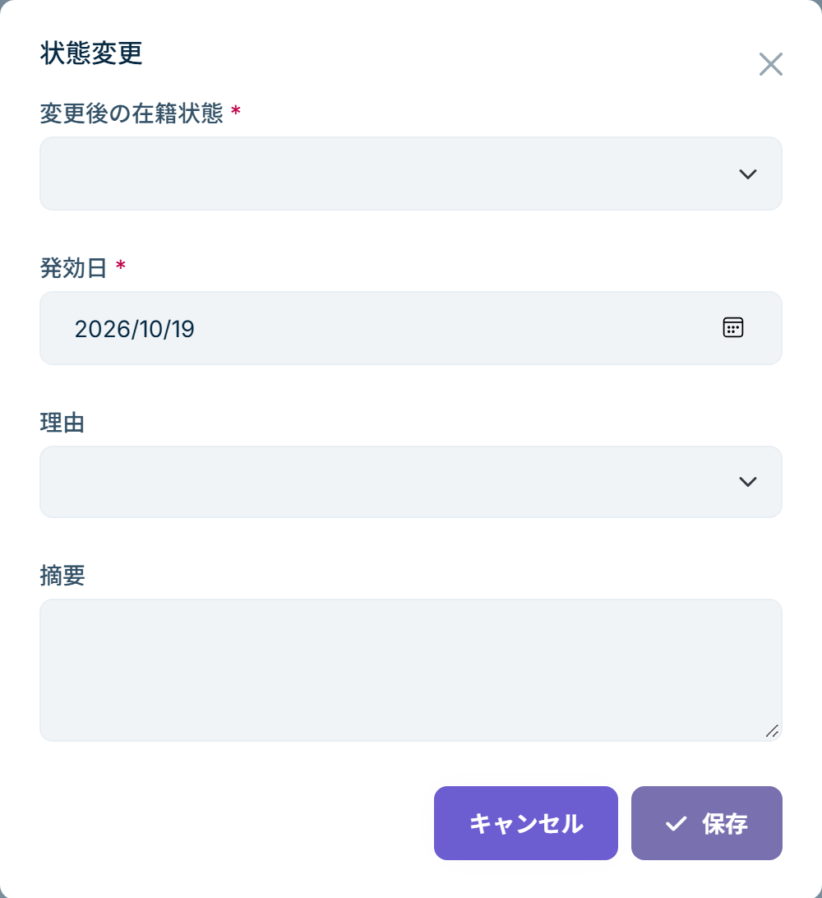

# 学籍の登録と管理

学籍には、学生の基本情報、連絡先、在留カード、旅券、学歴、経費支弁者などを記録します。在籍状態を変更すると、その履歴も残ります。

学籍は、左のメニューの「学籍管理」→「学籍一覧」で扱います。名簿がある場合は、[一括取込](student-import.md)を使うとまとめて登録できます。

## 学籍一覧

上部の条件で学生を絞り込めます。

- 学籍番号・氏名
- 在籍状態、国籍・地域、入学時期、クラス
- アカウント連携：アプリと連携済みの学生、まだの学生
- 在留期限が次の日以前：指定した日までに在留期間が満了する学生

「クリア」で条件を解除します。

在留期間の満了日が過ぎている学生と、30 日以内に満了する学生は、満了日が赤で表示されます。

各行の「操作」から、詳細の表示、編集、在籍状態の変更、削除ができます。

## 学生を登録する

1. 学籍一覧の「新規」を押します。
2. 項目を入力して保存します。

必須の項目は、**学籍番号、氏名（ローマ字）、生年月日、国籍・地域、入学時期、修業期間**です。ほかの項目は、わかっているものから入力し、後から追加できます。

- **学籍番号**：学校の中で重複しないようにします。削除した学籍の学籍番号は、再び使えません。
- **氏名（ローマ字）**：在留カードの表記に合わせると、照合がしやすくなります。漢字、カナ、母語の氏名、通称も記録できます。
- **国籍・地域**：一覧から選びます。
- **初期在籍状態**：新規登録のときだけ選べます。まだ入学していない学生は「入学予定」、すでに通っている学生は「在籍」にします。登録後の在籍状態は、このページの「在籍状態を変更する」の手順で変えます。
- **在留**：「初回の在留カードを同時に登録する」を選ぶと、登録と同時に在留カードも記録できます。

学生がアプリで学校に参加するときは、学籍番号、生年月日、在留カード番号で本人を確認することがあります。この 3 つは正確に入力してください。

## 学生の詳細

学籍一覧で学籍番号か、「操作」→「詳細」を押すと、詳細画面が開きます。上部の「状態変更」「編集」から、在籍状態の変更と学籍の編集ができます。

| タブ | 内容 |
|---|---|
| 基本情報 | 基本、連絡先、緊急連絡先、学籍、旅券、学歴、経費支弁者、進路・国保・備考 |
| 在留情報 | 在留カードの一覧。現在有効なカードと、以前のカード |
| 給与明細 | 学生が提出した給与明細。→ [給与明細](payslips.md) |
| アルバイト記録 | 学生が記録したアルバイト。→ [アルバイト記録](work-logs.md) |
| 学籍履歴 | 在籍状態の変更の記録 |
| アカウント連携 | アプリとの連携の状況、連携コードの発行。→ [学生のアプリ参加と学籍の連携](app-linking.md) |

## 在留カードを登録する

在留カードの更新などで新しいカードが交付されたら、新しいカードとして登録します。以前のカードは履歴として残ります。

1. 学生の詳細で「在留情報」タブを開きます。
2. 「新しい在留カードを登録」を押します。
3. 在留カード番号、在留資格、在留期間、在留期間の満了日、交付年月日、資格外活動許可の有無と種類・許可日を入力して保存します。

- 在留カード番号は `AB12345678CD` の形式（英字 2 文字・数字 8 桁・英字 2 文字）です。
- 在留資格と資格外活動許可には、現在のカードの内容が最初から入っています。変わった場合だけ直してください。
- 新しく登録したカードが「現在有効」になり、学籍一覧の在留期間の満了日と資格外活動許可もこのカードの内容になります。
- 登録した在留カードは編集できません。保存する前に、番号と日付を確認してください。
- 一覧では在留カード番号の一部が隠れています。「表示」を押すと番号全体が表示されます。

## 在籍状態を変更する

入学、休学、卒業、退学などで在籍状態が変わったら、在籍状態を変更します。変更は「学籍履歴」タブに記録されます。

1. 学生の詳細（または学籍一覧の「操作」）で「状態変更」を押します。
2. 変更後の在籍状態、発効日、理由を選び、必要なら摘要を入力して保存します。

- **発効日**：その状態になった日です。変更する日と違っていてもかまいません。過去の日付も入力できます。
- **理由**：休学、転学、退学、除籍、所在不明、その他に変更するときは必須です。卒業のときは、理由は自動で「卒業」になります。

変更できる在籍状態は、現在の在籍状態によって決まっています。

| 現在の在籍状態 | 変更できる在籍状態 |
|---|---|
| 入学予定 | 在籍、退学、その他 |
| 在籍 | 休学、転学、卒業、退学、除籍、所在不明、その他 |
| 休学 | 在籍、退学、除籍、所在不明、その他 |
| 所在不明 | 在籍、退学、除籍、その他 |
| その他 | 在籍、退学 |

転学、卒業、退学、除籍は最終の状態のため、ここからは変更できません。

## 学籍を編集する

学生の詳細の「編集」、または学籍一覧の「操作」→「編集」で、学籍の内容を変更できます。在籍状態は編集画面では変更できないため、「状態変更」を使ってください。

## 学籍を削除する

誤って登録した学籍は、学籍一覧の「操作」→「削除」で削除できます。削除には、学籍を削除する権限が必要です（`admin` にはあります）。

退学や卒業した学生は、削除せずに在籍状態を変更してください。学籍と履歴が残るため、後から確認できます。
