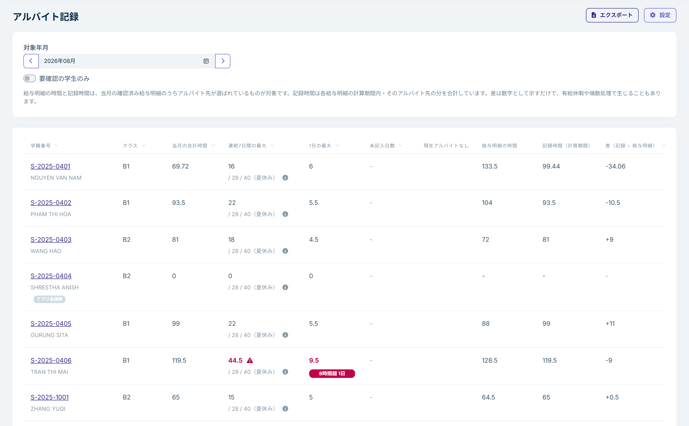
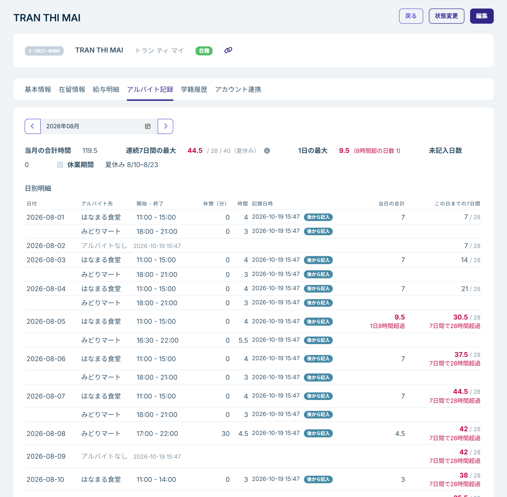

# アルバイト記録

資格外活動許可のある学生は、アプリで毎日のアルバイトを記録します。学校は、学生ごと・月ごとの時間を管理画面で確認し、提出された給与明細の時間と見比べることができます。

左のメニューの「学籍管理」→「アルバイト記録」で開きます。

## 学生がアプリで記録すること

- 勤務 1 回ごとに、アルバイト先、開始時刻、終了時刻、休憩時間を記録します。日付をまたぐ夜勤も 1 回として記録できます。
- アルバイトをしなかった日は、「アルバイトなし」をワンタップで記録します。
- しばらくアルバイトをしない期間は、「現在アルバイトなし」をオンにします。オンの間はリマインダーが届かず、未記入の日にも数えません。
- 過去の日の記録を後から追加・修正することもできます。

記録がまだの学生には、学校が設定した時刻にアプリへリマインダーが届きます。→ [リマインダーと長期休業期間](work-log-settings.md)

記録は学生本人の申告です。学校の画面から記録を修正することはできません。内容に誤りがあれば、学生にアプリで直してもらってください。

## 月ごとの一覧

「対象年月」の左右の矢印（前の月・次の月）で対象の月を切り替えます。年月を直接選ぶこともできます。一覧には、在籍中で資格外活動許可のある学生と、その月にアルバイトの記録か確認済みの給与明細がある学生が並びます。

| 列 | 内容 |
|---|---|
| 当月の合計時間 | その月に記録された時間の合計です（すべてのアルバイト先） |
| 連続7日間の最大 | その月のどの 7 日間をとっても、合計が最も多かった 7 日間の時間です |
| 1日の最大 | 1 日の時間が最も多かった日の時間です。8 時間を超えた日があると、その下に「8時間超 N日」と日数が表示されます |
| 未記入日数 | 昨日までの日のうち、勤務の記録も「アルバイトなし」もない日の数です（数え始める日は下記） |
| 現在アルバイトなし | 学生が「現在アルバイトなし」をオンにしているとき、「オン」と表示されます |
| 給与明細の時間・記録時間（計算期間）・差 | 給与明細との照合です（下記） |

未記入日数は、学生がアプリと連携した日、最初に勤務を記録した日、学校が最初にリマインダーを送った日のうち、いちばん遅い日から数えます。それより前の日は、記録がなくても数えません。連携したばかりの学生が過去の分をまとめて記録しても、未記入日数は増えません。

学生の名前の下には、必要に応じて「資格外活動許可なし」「アプリ未連携」「記録未開始」が表示されます。「記録未開始」は、まだ一度も勤務を記録していない学生です。この学生の未記入日数は数えません。給与明細を提出しているのに記録未開始の場合は、働いているのに記録していない可能性があります。

「要確認の学生のみ」を選ぶと、上限を超えている学生と、未記入の日がある学生だけを表示します。

### 上限の判定

資格外活動の上限を超えている数値は赤で表示されます。判定は次のとおりです。

- 1 日：8 時間（通年）。日付をまたぐ勤務は、勤務を始めた日の時間として判定します。
- 連続 7 日間：28 時間。7 日間すべてが学校の長期休業期間の中にある場合は 40 時間。

長期休業期間は学校で設定します。設定がなければ、すべての 7 日間を 28 時間で判定します。→ [リマインダーと長期休業期間](work-log-settings.md)

## 給与明細との照合

一覧の右側の 3 列で、学生が記録した時間と、確認済みの給与明細の労働時間を見比べられます。

- **給与明細の時間**：その月の確認済みの給与明細のうち、アルバイト先が選ばれているものの労働時間の合計です。
- **記録時間（計算期間）**：同じ給与明細それぞれの計算期間（例：9/16〜10/15）の中で、そのアルバイト先について記録された時間の合計です。
- **差（記録 − 給与明細）**：記録時間から給与明細の時間を引いた値です。

差は数字として示すだけです。有給休暇や端数の処理で差が出ることもあります。アルバイト先が選ばれていない給与明細は照合に含まれず、「アルバイト先未選択の給与明細 N 件」と表示されます。学生はアプリの給与明細の詳細から、後でアルバイト先を選べます。

「当月の合計時間」と「記録時間（計算期間）」は、数える期間が違うため、同じ値にはなりません。前者はその月の 1 日〜末日、後者は給与明細の計算期間です。

## 学生ごとの記録

学生の詳細の「アルバイト記録」タブで、その学生の月ごとの記録を確認できます。

- **日別明細**：日ごとの勤務（アルバイト先、開始、終了、休憩、時間）、当日の合計、この日までの 7 日間の合計です。長期休業期間の日には「休業期間」と表示されます。
- **記録日時**：学生が記録した日時です。その日より後に記入したものには「後から記入」、記録後に修正したものには「修正あり」と表示されます。
- 上限を超えた日には「1日8時間超過」「7日間で28時間超過」などと表示されます。
- 日付をまたぐ夜勤は、「開始 - 終了」に `22:00 - 06:00 (+1)` のように表示されます。「当日の合計」と「この日までの7日間」は、夜勤を 0 時で分けて、それぞれの日に数えた時間です。一方、1 日 8 時間の判定は、夜勤を分けずに勤務を始めた日の時間として行います。そのため、前の晩からの夜勤の分を含めて「当日の合計」が 8 時間を超えていても、「1日8時間超過」が表示されないことがあります。
- **給与明細との照合**：その月の確認済みの給与明細ごとに、アルバイト先、計算期間、給与明細の時間、記録時間、差を表示します。

## Excel に出力する

一覧の「エクスポート」を押すと、表示中の月の内容を Excel ファイルで出力します。ファイルには次のシートがあります。

- **月次集計**：一覧と同じ内容
- **日別明細**：学生ごと・日ごとの勤務
- **給与明細との照合**：給与明細ごとの照合結果

出力には「エクスポート」の権限が必要です（`staff` と `admin` にはあります）。
